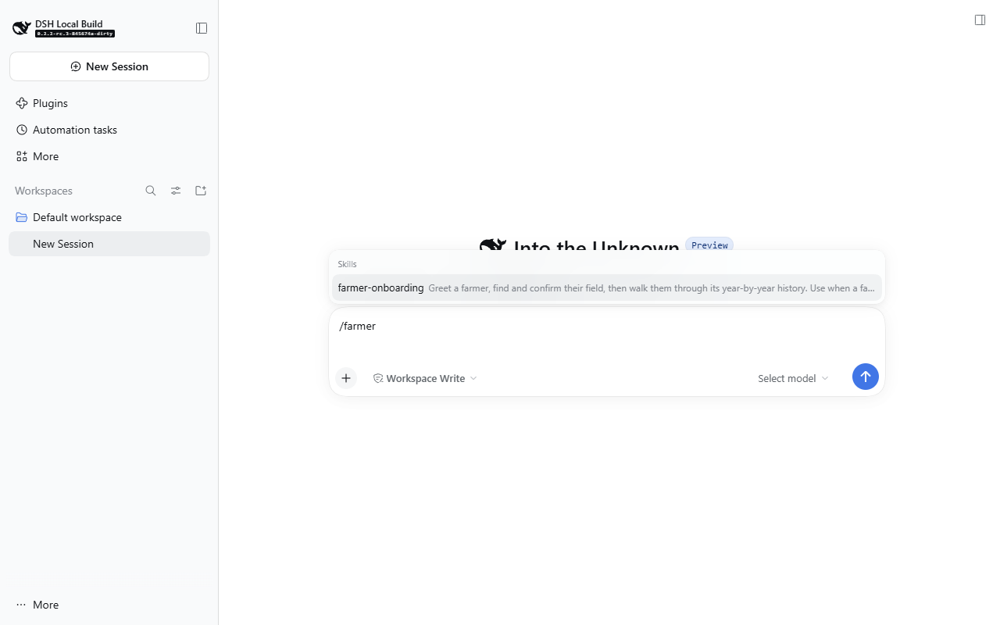

# Field history and onboarding: handoff

Written 14 November 2026. The implementation from [`onboarding-field-history`](https://github.com/Metaspectral/fieldwork/tree/onboarding-field-history) is merged into `main`. It is now a built-in modular plugin in the default Fieldwork composition. The [onboarding guide](README.md) describes first-run model setup, progress, and pause/resume; `dev.patch.yml` remains available for standalone development. See the [verified model preview and screenshots](../screenshots/jon-onboarding/README.md).

## What this is

One DeepSeek Harness plugin, `fieldwork-onboarding`. It gives an agent six tools and one conversation script so it can:

1. find a farmer's field,
2. ask "Is this your field?",
3. show the crop grown each year for the last ten years, a mark for each of five problems, and the field's risks in ranked order,
4. ask "Sound right?" and save corrections.

It stops there. Suggesting rotations, and the questions about equipment, leases and money, are other people's parts.

**It is a working skeleton, not a finished product.** The rules and the plumbing are real and tested. Much of the data is either invented or not connected. The section "Everything that is fake, assumed or cut short" lists all of it.

## Links

Code and documents in this repository:

- This package: [fieldwork/onboarding](https://github.com/Metaspectral/fieldwork/tree/onboarding-field-history/fieldwork/onboarding)
- The conversation script: [SKILL.md](skills/farmer-onboarding/SKILL.md)
- Every threshold: [settings.js](settings.js). The crop table: [crops.js](crops.js). Every invented value: [pretend-data.js](pretend-data.js)
- Team setup: [SETUP.md](../SETUP.md). Product direction in this repository: [README.md](../README.md), [architecture.md](../docs/architecture.md)
- The other Fieldwork packages: [plugins](../plugins/README.md), [ui](../ui/README.md)
- Harness documents used to build this: [first plugin](../../docs/user/develop/basic/index.md), [tools](../../docs/cookbook/adding-a-tool.md), [packaging](../../docs/user/develop/basic/publish.md), [asking the user questions](../../packages/interaction/tool-ask-user/README.md), [skills](../../packages/skill/skill/README.md), [agent presets](../../packages/preset/agent-preset/README.md)

Data sources. The first four are the ones this code calls, and they answered on 14 November 2026:

- [NASA POWER](https://power.larc.nasa.gov/docs/services/api/): daily weather. No account
- [USDA Cropland Data Layer (CropScape)](https://nassgeodata.gmu.edu/CropScape/): crop each year. No account
- [USDA Soil Data Access](https://sdmdataaccess.sc.egov.usda.gov/): soil survey. No account
- [US Census geocoder](https://geocoding.geo.census.gov/geocoder/): county and state. No account
- [NASA Earthdata login](https://urs.earthdata.nasa.gov/): needed for [Harmonized Landsat and Sentinel-2](https://hls.gsfc.nasa.gov/) images and [GRACE](https://grace.jpl.nasa.gov/) stored water
- [OpenET](https://etdata.org/): water used by crops. Needs an account key
- [USDA Quick Stats](https://quickstats.nass.usda.gov/api): price records. Needs a free key

Design work. These sit in Jon's Claude account and open only for him; ask him for an export:

- [Mockup of every screen](https://claude.ai/artifact/8PhXqVzPocUnzKm4kxY6Gk)
- [The experience, stage by stage](https://claude.ai/artifact/DcfaqJo6uDZqsVuCi8F6q1)

## What it looks like

**There are no screens for this plugin.** It runs inside the harness's chat window. The only screenshot that can be taken without a model is this one: the harness finds the skill and offers it as a command.



The [model preview](../screenshots/jon-onboarding/README.md) now shows a real Codex conversation using invented data. Below is the original tool output copied from Jon’s run against live services for the Finney County point.

`field_history`, crops only (first visit, about 12 seconds):

```text
Field field_38.0575_-100.9512. Crops only so far; call again with part "all" for the problems.
2016 wheat
2017 corn
2018 wheat
2019 corn
2020 corn
2021 wheat
2022 corn
2023 wheat
2024 alfalfa
2025 alfalfa
Current rotation: no repeating pattern found.
```

`year_detail` for 2022:

```text
2022, corn:
- drought and heat: bad (true for your region)
    season rain: 9.7 inches; 30-year average: 13.3 inches
    hot days: 62 days at or above 95°F; the top fifth of 30 years starts at: 59 days
    crop greenness at its peak: no reading
- water: no reading
- topsoil: fine (estimated for your field). Counts soil moved by rain only, not by wind.
    soil lost: 0.4 tons an acre; this soil can lose: 5 tons an acre
- salt: fine (true for your region). One reading for the whole period, from the soil record.
    salt in the soil: 1 deciSiemens per metre; watch from: 2 deciSiemens per metre
- costs: no reading
```

`field_risks`:

```text
Top risk: drought and heat. Bad in 2 of 5 years (2021–2025), against 0 of 5 years (2016–2020) before.
All risks, highest first (region-only ones last):
1. topsoil: low (estimated for your field); bad never; watch never
2. drought and heat: medium (true for your region); bad 2022, 2024; watch 2018, 2020
3. salt: low (true for your region); bad never; watch never
Current rotation: no repeating pattern found.
No reading for: crop greenness (...); water the crop used (...); the region's stored water (...); fertilizer prices (...).
```

For the look the rest of Fieldwork has, see the screenshots of the other pages: [My farm](../screenshots/farm.png), [Seed costs](../screenshots/seed-costs.png), [Experiments](../screenshots/experiments.png), [Community](../screenshots/community.png), [on a phone](../screenshots/mobile.png). None of them shows the field history.

## What has been checked, and what has not

Checked:

- 46 tests pass (`test/rules.test.js`, `test/tools.test.js`). They use stand-in data sources and never touch the network.
- One manual run against the live services, for a cropland point in Finney County, Kansas (38.0575, -100.9512) with an invented size of 126 acres. Crops, drought and heat, topsoil and salt came back. A first visit took about 12 seconds; a second took about 10 milliseconds.
- The harness starts with the plugin loaded and prints `[fieldwork-onboarding] loaded: 6 tools and the farmer-onboarding skill (pretend data)`.
- The harness finds the skill: typing `/farmer` in the chat box offers `farmer-onboarding` (see the screenshot above).

Not checked:

- The complete interactive onboarding sequence has not been run. The read-only model preview verified skill discovery and `find_field`, `field_history`, `field_risks`, and `year_detail` using invented data.
- Installing the package with `dsh plugin add`. Only loading it from this checkout has been tried.
- Real-data services were not rechecked during integration. Co-loading with the current Fieldwork plugins, UI, and Codex bridge was verified in the read-only model preview.
- Any field outside Kansas. Any field in Alaska or Hawaii.

## How to run it

Needs Node 24.9 or newer. On Jon's machine Node 24.22.3 is installed beside the default Node 22 and is not the default.

```sh
pnpm install
pnpm run build

# tests
pnpm --filter fieldwork-onboarding test

# the harness with this plugin, pretend data on
DSH_HOME="$PWD/.fieldwork/dev-runtime" DSH_TELEMETRY_DISABLED=1 \
  pnpm dsh --profile web --patch fieldwork/onboarding/dev.patch.yml --no-open
```

To use real data, set `FIELDWORK_PRETEND=0` before starting, or add `config: { pretend: false }` to the row in `dev.patch.yml`. Real data sends the field's latitude and longitude to four outside services (listed below).

## The files

| File | What it holds |
|---|---|
| [`index.js`](index.js) | The plugin: the six tools, their output shapes, the text the model reads, saved answers |
| [`history.js`](history.js) | The rules: levels for each problem, rotation, ranking. No network code |
| [`sources.js`](sources.js) | Fetching from outside services, and the four sources that are not connected |
| [`settings.js`](settings.js) | Every threshold |
| [`crops.js`](crops.js) | The hand-entered crop table |
| [`pretend-data.js`](pretend-data.js) | Every invented value |
| [`skills/farmer-onboarding/SKILL.md`](skills/farmer-onboarding/SKILL.md) | The conversation order and wording rules |
| [`cordis.patch.yml`](cordis.patch.yml), [`dev.patch.yml`](dev.patch.yml) | How the harness loads the plugin (installed, and from this checkout) |

The tools: `find_field`, `field_history`, `year_detail`, `field_risks`, `correct_year`, `save_field_note`.

---

## Everything that is fake, assumed or cut short

### 1. Invented data

All of it lives in `pretend-data.js` and is returned whenever the pretend switch is on. **The switch is on by default** (`index.js` line 345).

| What is invented | Where | What a real version needs |
|---|---|---|
| The field: 126 acres, Finney County, Kansas, irrigated, "Richfield silt loam", 1% slope | `FIELD`, line 17 | Nothing; real mode already replaces it |
| The ten-year grid of crops and marks, 2016 to 2025 | `GRID`, line 37 | Real mode replaces it, as far as sources are connected |
| The "how sure" label for each problem | `SURE`, line 14 | In real mode the label comes from which data was actually used |
| Readings for 2022 only (9 inches of rain, 41 hot days, 24 inches of water, 6.4 tons of soil, $171 an acre) | `READINGS`, line 53 | Real mode works these out. The other nine pretend years have no readings at all |
| "Low" salt as a word, not a number | `READINGS` | Real mode gives a number in deciSiemens per metre |
| `windNotCounted: true` | line 88 | Real mode works it out from rainfall |

Behaviour that is fake while the switch is on:

- `find_field` ignores the point it is given and always returns the same field (`index.js` line 390).
- A corrected crop changes the crop only. Water, topsoil and costs are **not** worked out again, because there is nothing to work them out from.
- The years are fixed at 2016 to 2025 whatever today's date is.

Two pretend notes were changed from the mockup on purpose, because no listed source can support them: 2022 water no longer says "groundwater down 2.1 feet", and 2022 topsoil no longer says "mostly wind". **The mockup screens still say both and need changing.**

### 2. Data sources that are not connected

These four are stubs that return nothing (`sources.js` lines 140 to 143). The rules that use them are written and tested with stand-in numbers; only the fetching is missing.

| Source | Needs | What is empty until it is connected | Shape the rules expect |
|---|---|---|---|
| Crop greenness (NASA's Harmonized Landsat and Sentinel-2 images) | NASA Earthdata login, plus code to read images inside the field edge | The "crop hit" part of drought and heat. Without it, drought and heat can only ever be "true for your region" | `{ 2022: 0.71 }`: peak greenness per year, 0 to 1 |
| Water the crop used (OpenET) | Account key | Water is "no reading" every year | `{ "2022-7": 6.2 }`: inches per year-month |
| The region's stored water (NASA GRACE and GRACE-FO) | NASA Earthdata login | Water is "no reading" every year | `{ 2022: -3.1 }`: change that year; below zero means it fell |
| Fertilizer prices (USDA price records) | Free key | Costs is "no reading" every year | `{ 2022: 0.62 }`: dollars per pound |

So today, on real data, **only drought and heat, topsoil and salt ever get a reading.** Water and costs never do.

Known limits to handle when connecting them (from the spec): GRACE has a gap from mid-2017 to mid-2018 and covers regions hundreds of kilometres wide; OpenET covers the western United States only; nobody has checked which years OpenET has.

### 3. Sources that are connected, and their shortcuts

| Source | Used for | Shortcut taken |
|---|---|---|
| US Census geocoder | County, state, and whether the point is in the United States | "In the United States" simply means the Census found a county |
| USDA Cropland Data Layer, through a point lookup hosted at George Mason University | Crop each year | See "The field and its crops" below |
| NASA POWER | Daily rain and hottest temperature, 31 years | It is for an area about 50 kilometres across, not the field. Fetched once and never refreshed unless the year range changes |
| USDA soil survey | Soil name, slope, tolerable soil loss, erodibility, salt | One lookup at the centre point only, taking the largest soil component there. A field with two soils gets one |

None of these has a fallback. If one is down, that part is "no reading" and the reason is passed to the agent.

### 4. The field and its crops

- **No field edge.** The spec asks for a polygon. The code takes a centre point and acres and assumes a circle. There is no lookup of real field boundaries and no map to tap.
- **No place search.** `find_field` needs latitude and longitude. The onboarding skill now prohibits guessing a point from a place name.
- **Acres and irrigation come from the farmer.** No source is used for either. Until the farmer answers, water and salt are left out.
- **The field's id is its rounded coordinates** (`index.js` line 394). Two fields whose centres are within about 10 metres collide. There are no accounts and no owner.
- **Crops are read at 5 points, not across the field** (`settings.js`, `samplePoints`): the centre and four points at 60% of the radius (`sources.js` line 48). The spec asks for the most common crop inside the edge. The crop map's area summary returned nothing when tried, so points were used instead. With 5 points, "under 60% of the field" means 2 of 5 points disagree.
- **The crop map service is slow and stalls.** Each point is one request, with a 12 second limit and one retry (`sources.js` line 11). A first visit makes 50 requests.
- **Lower 48 states only.** The map projection in `toCropMapGrid` is for the lower 48. Alaska and Hawaii would pass the "in the United States" check and then read the wrong place.
- **Only eight crop map names are translated** (`crops.js` line 23). Everything else, including double crops such as winter wheat followed by soybeans, passes through as its lower-cased map name. Those crops have no row in the crop table, so they get no topsoil or costs reading and a default growing season.
- **Fallow has no crop table row**, so a fallow year gets no topsoil reading, which is the year soil loss matters most.
- **Rotation detection is exact.** It finds a pattern only if the crops repeat perfectly at least twice. One odd year, or one unknown year, gives "no repeating pattern found". The real run found none.

### 5. The crop table

`crops.js` line 14. **Every number in it was typed in as a rough guess and has not been checked against any agronomy source**: growing months, the temperature that counts as a hot day, water need, fertilizer need, and ground cover. Every level depends on these. It also treats all wheat as winter wheat (sown the autumn before), and has one row per crop with no regional differences.

### 6. The rules

All thresholds are in `settings.js` and are the spec's starting values. None has been tuned against real fields. Beyond that:

| Rule | Shortcut or assumption | Where |
|---|---|---|
| Drought and heat | "Usual greenness" needs only two years of the same crop | `history.js` line 243 |
| Drought and heat | A month counts if it has 20 or more days of weather. This number is not in the settings file | `history.js` line 180 |
| Water | Shortfall is water used minus rain over the crop's growing months. Needs every month present | `computeHistory` |
| Topsoil | Rain's erosive force is estimated from yearly rainfall with a published shortcut formula, not taken from real storm records. The constants are in the code, not the settings file | `soilLoss`, line 63 |
| Topsoil | Slope comes from the soil survey, not elevation data as the spec says. Slope length is assumed to be 150 feet for every field | `settings.js` |
| Topsoil | Ground cover is one fixed number per crop. The spec asks for cover from the crop **and the days the ground sat bare**; bare days are not counted | `crops.js` |
| Topsoil | Counts rain only. In dry, windy places most loss is wind, so real results look falsely reassuring: the Finney County run gave 0.4 tons an acre against a limit of 5. A note says so, but there is no wind estimate | `topsoilResult` |
| Salt | Uses the soil survey's surface-layer figure. "Dry climate" means under 20 inches of rain a year on average | `settings.js` |
| Costs | Fertilizer only, as one "pounds of nutrients" figure per crop. Weed-control costs, which the handoff also names, are not included | `crops.js` |
| All levels | When one input is missing, the level comes from the inputs that exist. So a "fine" can rest on partial data. The missing reading is listed beside it, but the mark itself looks the same | `levelFromSignals`, line 37 |
| Ranking | The spec ranks field-level problems first. That put a zero-score problem on top ("Top risk: topsoil. Bad in 0 of 5 years"), so the headline uses the highest-ranked problem that scored above zero. This departs from the spec | `index.js`, `field_risks` |
| Ranking | "Thirstiest crop" is read from the crop table, not measured | `thirstiestCrop`, line 278 |
| Years | "The last ten full years" is taken from the computer's clock | `index.js` line 349 |
| Units | Inches, Fahrenheit, acres, tons an acre, dollars. No metric | throughout |

### 7. Saving and privacy

- **Farmer answers are one JSON file on the machine running the harness**: `fieldwork/onboarding.json` inside the harness's data folder (`index.js` line 304). Gathered data sits beside it in `field-data/`, one file per field. This follows the earlier proof of concept; nobody decided it.
- One process at a time. No accounts, no login of its own, no encryption, no backup, no way to delete a field.
- **Saved data never expires.** A year's crop, once fetched, is kept for good. Changing `samplePoints` does not refetch.
- Corrections can change a year's crop and add a note. They **cannot** change a mark, and there is no undo. Notes can only be added.
- **Real mode sends the field's location to NASA, the USDA crop map host, the USDA soil survey and the US Census, with no notice to the farmer.** The architecture document says outside data use must be visible. Nothing shows it yet.

### 8. The agent and the conversation

- **Built-in Fieldwork preset.** The default Fieldwork launcher creates its setup Session with the Fieldwork preset, native question and skill tools, and the Fieldwork persona. The onboarding tools remain Host-registered and can also be visible to other presets; this is not a separate onboarding-only agent preset.
- The skill is registered by the plugin when it loads rather than placed in `.dsh/skills/`, because that folder is ignored by git. The harness lists it as a command, but no agent has run it.
- "Crops first, then problems" depends on the agent calling `field_history` twice, as the skill tells it to. Nothing enforces it.
- The wording rules (no predictions, no satellites, plain words) are instructions in `SKILL.md`. Nothing checks that the model follows them.
- English only. The rest of the repository keeps Chinese translations of its documents.

### 9. No screens

There is no interface. A farmer sees chat text and the harness's question cards, not the phone mockup. The mockup's history grid, the map for picking a field, and the one-tap correction do not exist. `fieldwork/ui` now shows how to add pages inside the harness; a history page fed by these tools would be new work.

### 10. Packaging and housekeeping

- `cordis.patch.yml` (the installed route) has never been exercised.
- The plugin announces itself with `console.log`, because the harness's own logger did not show the line.
- Network time limits are constants in `sources.js` (lines 9 and 11), not in the settings file.
- No README for the package, and no entry in the Fieldwork README.
- Integrated with `fieldwork/start.mjs` through the default source composition. Do not add the standalone development overlay to that launcher.

---

## Decisions nobody has made

1. Which model the agent uses, and whose key. Blocks the first real conversation.
2. Who gets the three accounts: NASA Earthdata, OpenET, USDA price records. Blocks water, costs and field-level drought.
3. Where farmer data lives, and who may read it.
4. Whether the demo runs on pretend data, real data, or one real field prepared in advance.
5. Whether to build a history page, and whether it sits in `fieldwork/ui`.
6. Whether wind erosion gets an estimate or topsoil is left out for dry regions.
7. How this fits with the workspace in `fieldwork/plugins`, which has a different product direction (current practice, experiments, community) from the rotation tool this plugin was specified for.

## Suggested order

1. Continue testing the full farmer onboarding conversation; the built-in first question has been verified with Codex, while the complete interactive sequence remains unqualified.
2. Rebuild after the pull and confirm this loads beside `fieldwork/plugins`.
3. Add the farmer agent preset.
4. Have someone who knows crops check `crops.js`.
5. Connect fertilizer prices (a free key, the smallest job), then OpenET, then greenness.
6. Replace the circle with a real field edge and count crops across it.
7. Decide on screens.
