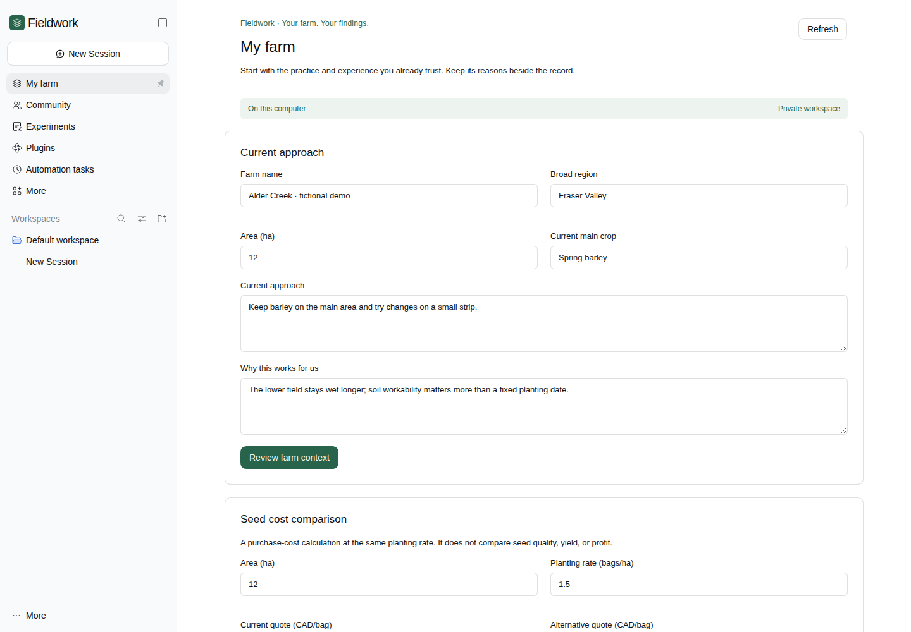
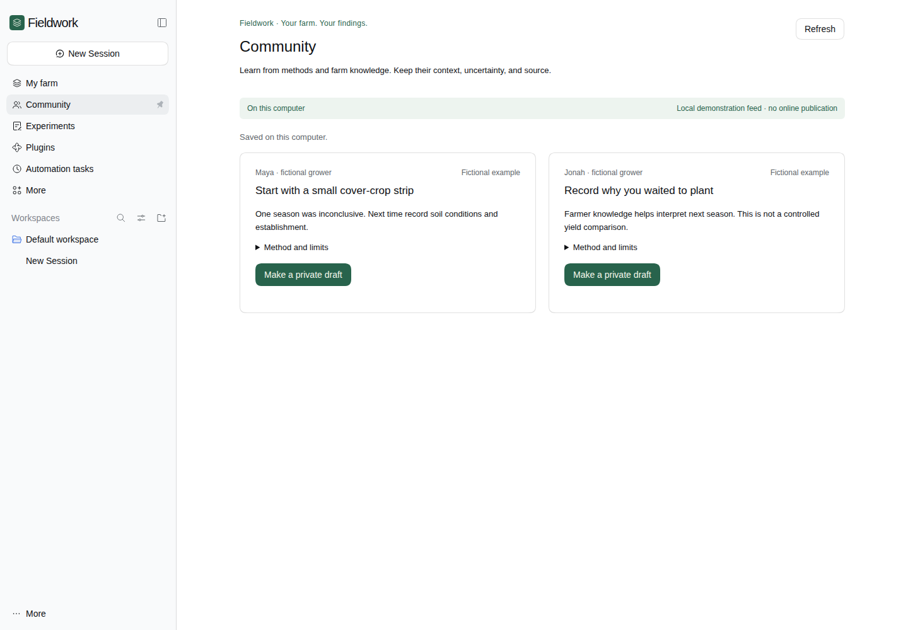
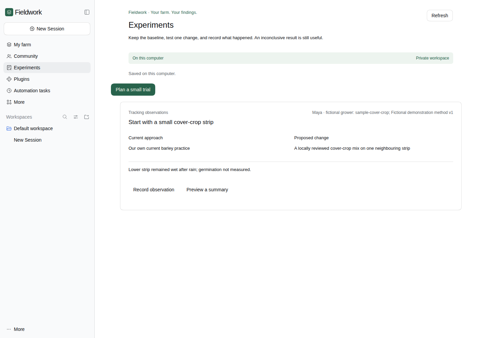
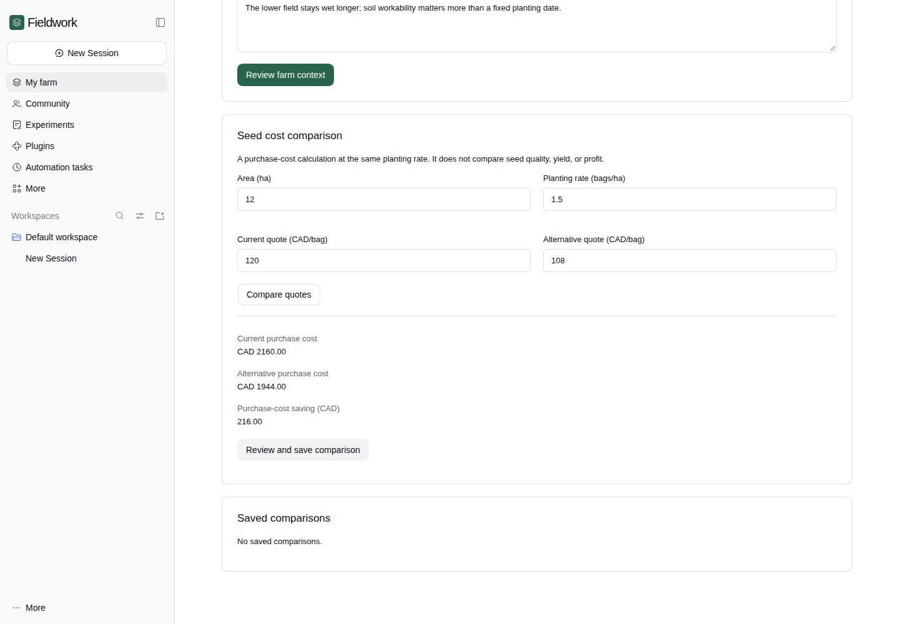
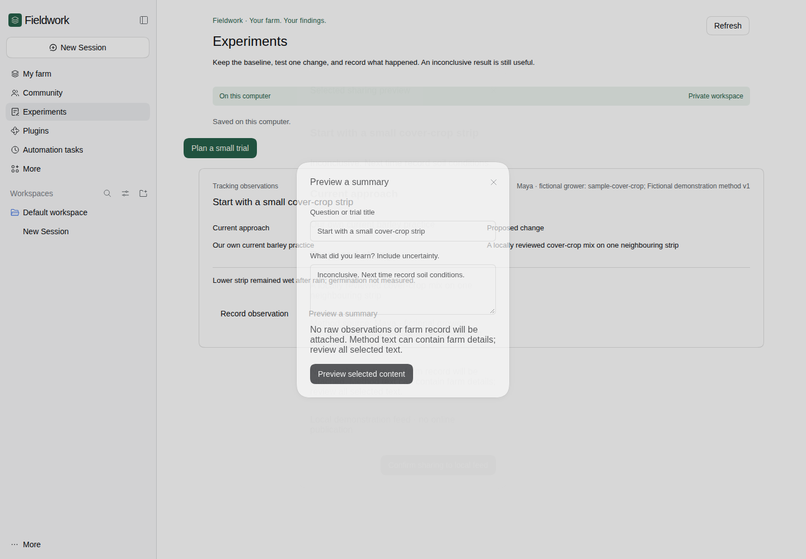
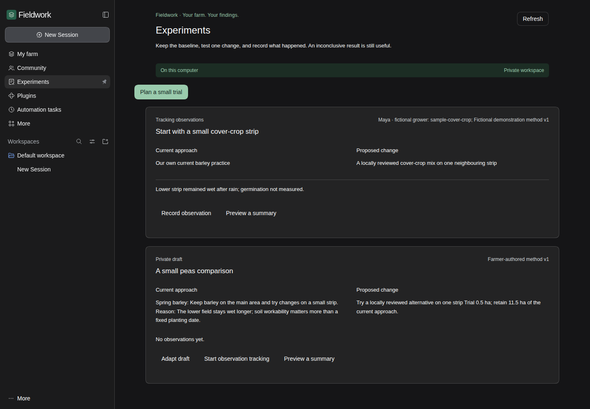
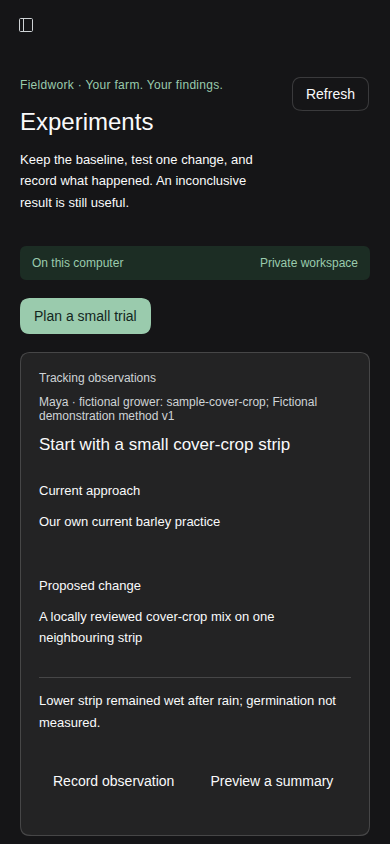

# Fieldwork screenshots

English | [中文](README.zh.md)

Actual captures of the native DeepSeek Harness plugins with the Fieldwork starter identity. All farm names, methods, observations, and costs shown are fictional demonstration data. Community is a local feed with no online publication.

Captured on 2026-11-14 using the isolated browser workflow in `fieldwork/ui/browser.test.mjs`. Desktop captures use 1440 × 1000; the phone view uses 390 × 844. The test consumes no model subscription.

See [field learning](field-learning/README.md): method discovery, availability checks, scouting, and reviewed comparisons.

See [corn planning and the source library](corn-and-evidence/README.md): original spreadsheet citations, reviewed seed budgets, and revision-linked observations.

See the [built-in onboarding flow](built-in-onboarding/README.md): model setup, automatic first question, and pause/resume controls.

See also [Jon’s field-history plugin preview](jon-onboarding/README.md), captured using invented corn/soybean data before the plugin was merged into main.

## My farm

Capture current practices and the reasons behind them.

## Community

Browse fictional methods and adapt one into a private draft.

## Experiments

Keep the baseline, track a change, and record observations.

## Seed costs

Compare purchase costs with explicit units and assumptions.

## Sharing review

Review selected summary text before sharing to the local feed.

## Dark theme

Native controls and Fieldwork accents in dark mode.

## Phone layout

Responsive experiment view; phone pairing is not implemented.

## Refresh the gallery

From the repository root, run `pnpm run fieldwork:build`, then `FIELDWORK_BROWSER_CHANNEL=chrome node --test fieldwork/ui/browser.test.mjs`. Omit the channel variable when using Playwright's installed browser. Inspect `.artifacts/native-pages/` and copy the seven named PNGs into this directory. Keep private runtime records and authentication URLs out of captures.

[Beltsville investigation: original files, yield-point quality, and local work](investigations/README.md).
