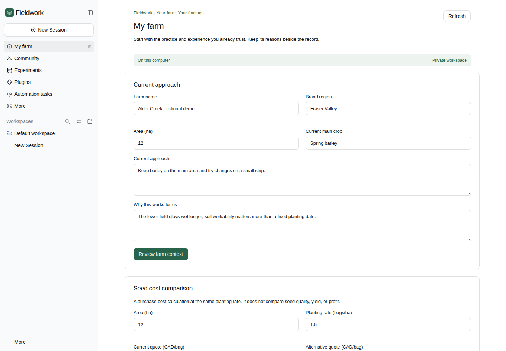
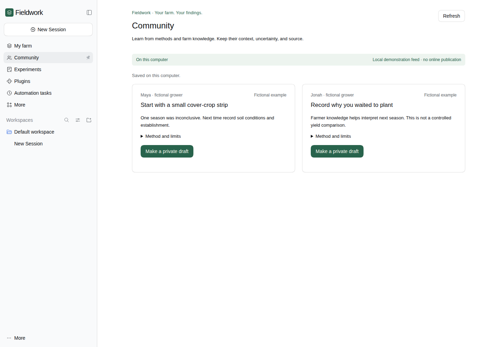
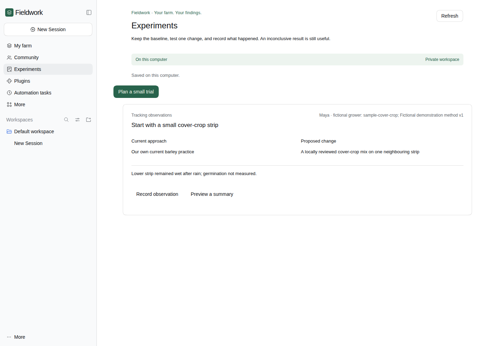
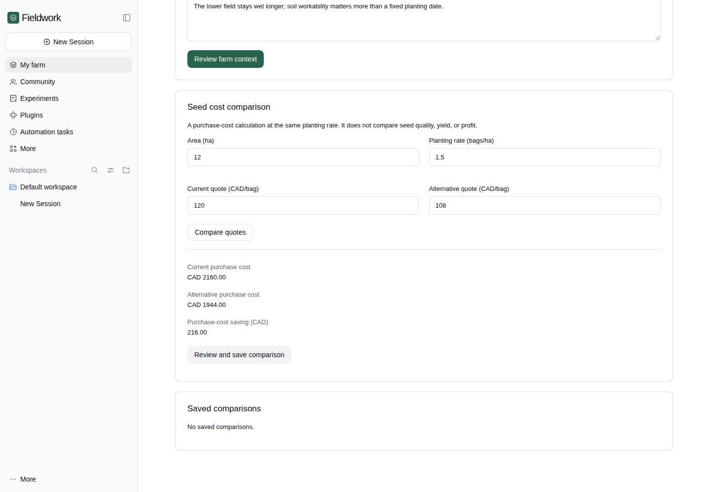
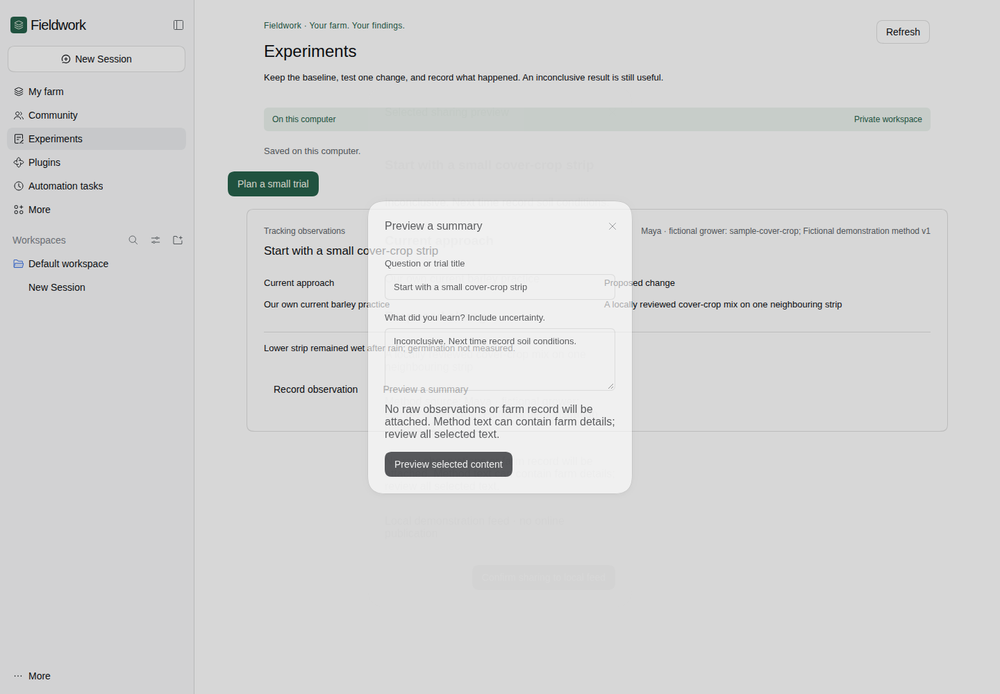
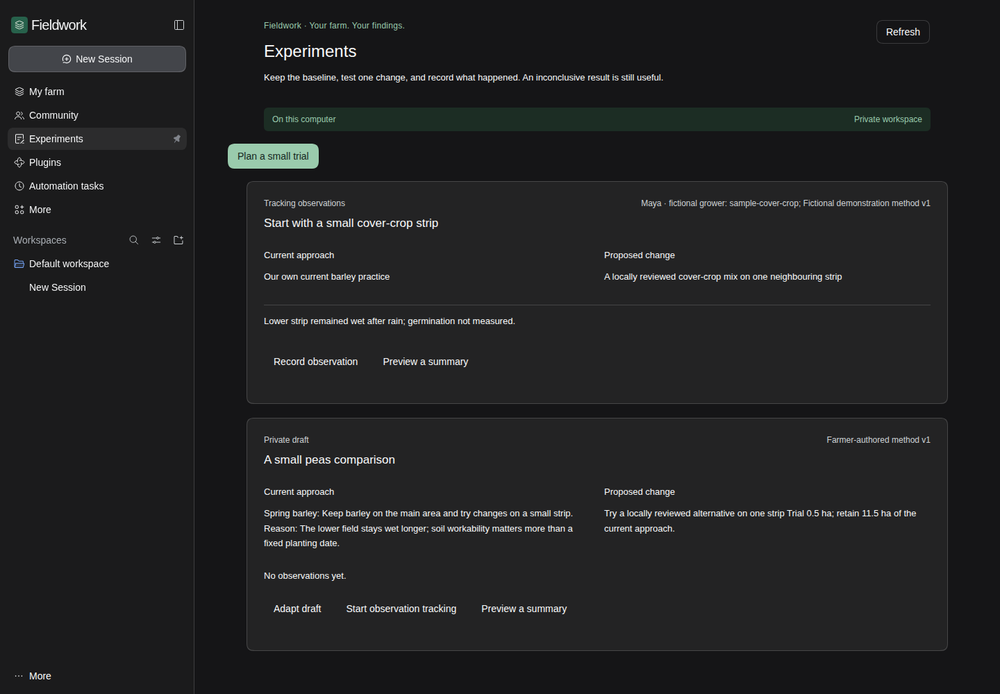
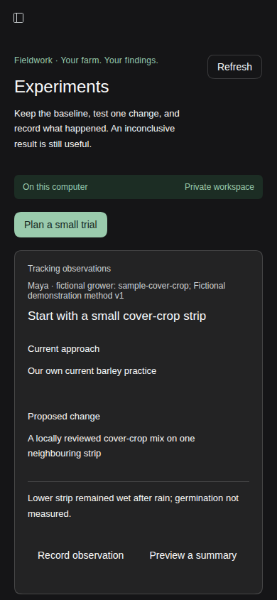

# Fieldwork 截图

[English](README.md) | 中文

采用 Fieldwork 初始品牌的原生 DeepSeek Harness 插件实际截图。所有展示的农场名称、方法、观察及成本均为虚构演示数据。社区是本地动态，不会在线发布。

于 2026-11-14 使用 `fieldwork/ui/browser.test.mjs` 中的隔离浏览器流程捕获。桌面截图为 1440 × 1000；手机视图为 390 × 844。测试不消耗模型订阅。

参见[田间学习](field-learning/README.zh.md)：方法发现、数据可用性检查、巡田及已审核比较。

参见[玉米规划及来源库](corn-and-evidence/README.zh.md)：原始表格引用、经过审核的种子预算及关联版本的观察。

参见[内置入门流程](built-in-onboarding/README.zh.md)：模型设置、自动首问及暂停和继续控件。

另见 [Jon 的田地历史插件预览](jon-onboarding/README.zh.md)，截图于插件合并到 main 前捕获，使用虚构的玉米及大豆数据。

## 我的农场

记录当前做法及其背后的理由。

## 社区

浏览虚构方法，将其改编为私人草稿。

## 试验

保留基线、跟踪改变并记录观察。

## 种子成本

明确单位及假设，比较采购成本。

## 分享审查

在分享到本地动态前审查选定摘要文本。

## 深色主题

深色模式中的原生控件及 Fieldwork 强调色。

## 手机布局

响应式试验视图；尚未实现手机配对。

## 更新图库

在仓库根目录运行 `pnpm run fieldwork:build`，然后运行 `FIELDWORK_BROWSER_CHANNEL=chrome node --test fieldwork/ui/browser.test.mjs`。使用 Playwright 已安装的浏览器时省略频道变量。检查 `.artifacts/native-pages/`，将这七个命名 PNG 复制到此目录。截图不得包含私人运行时记录及认证链接。

[Beltsville 调查：原始文件、产量点质量及本地任务](investigations/README.zh.md)。
