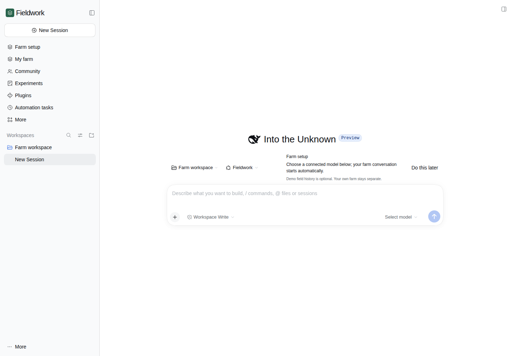
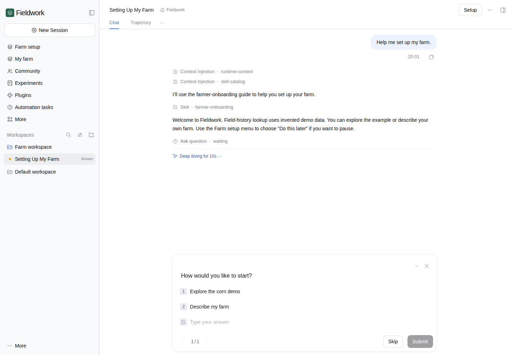
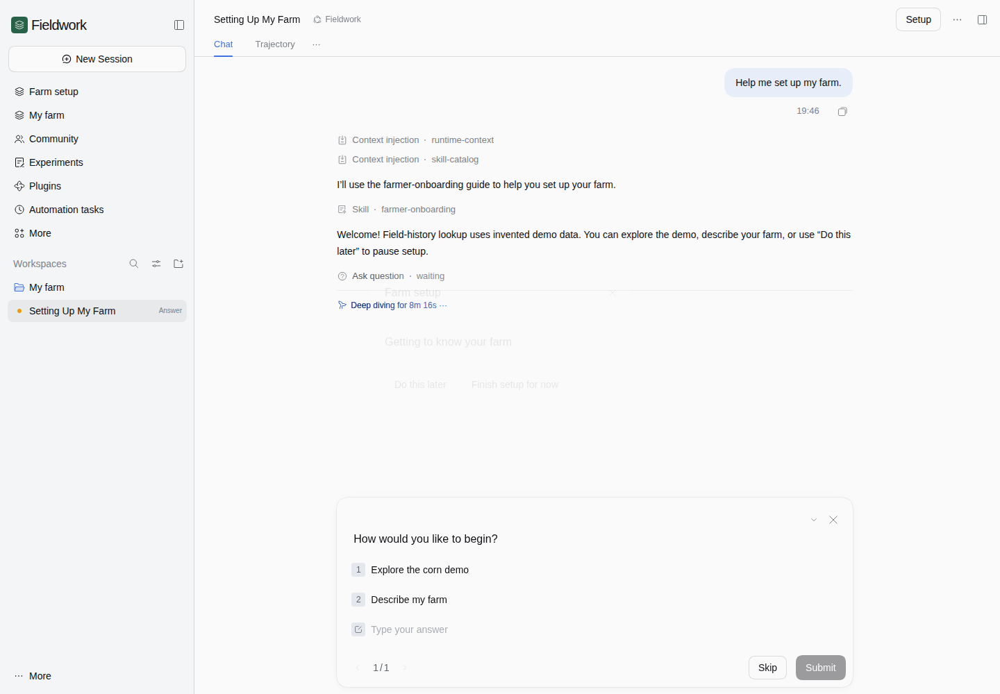
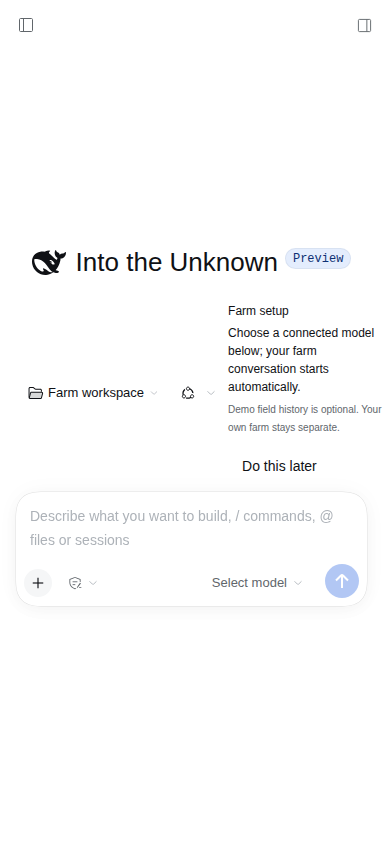
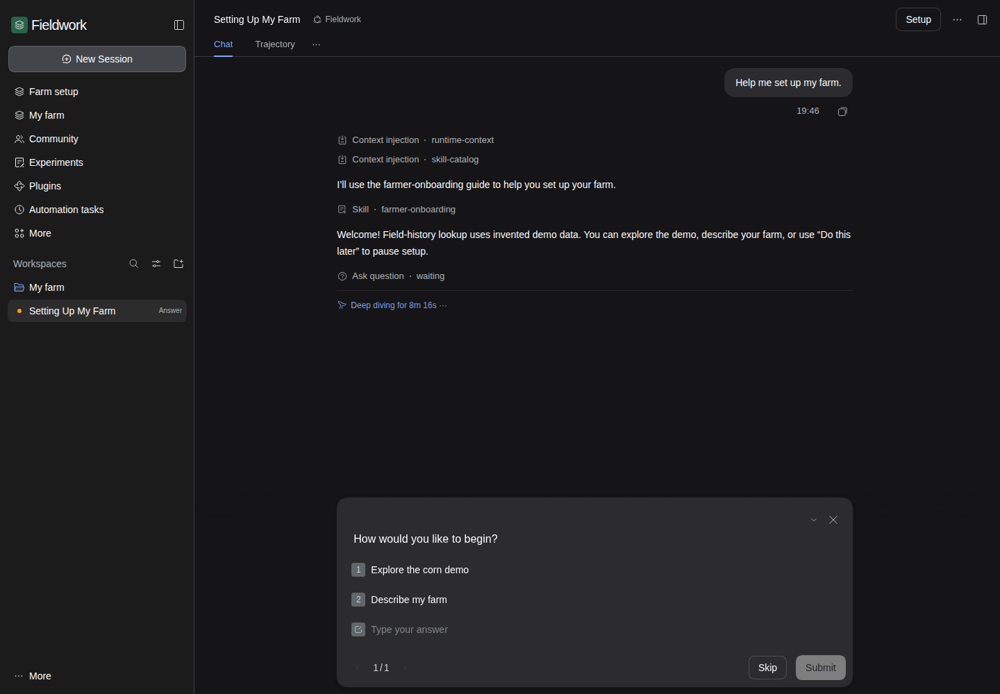

# Built-in onboarding captures

English | [中文](README.zh.md)

Actual native Harness captures of the built-in Fieldwork setup flow, captured on 2026-11-14. Model setup is shown before a model request. The first question and waiting state come from a real `gpt-6.1-sol` Codex subscription conversation, not the keyless test provider. No actual farm information was entered.

## Connect the agent

The saved setup conversation waits for a connected model.

## First farm question

After model selection, Codex loads the onboarding skill and asks how to begin.

## Pause or finish

The Setup menu remains available while a native question is waiting.

## Phone layout

The model-setup hint and controls fit the 390-pixel phone viewport.

## Dark theme

The native onboarding question and Setup control in dark mode.

The preview verified selecting a model, automatic skill loading, the native first question, pausing a pending question, and reopening the same Session without a second greeting. Separate keyless browser checks cover a preconfigured model, reloads, multiple tabs, and explicit completion. Field-history lookup is still invented demo data, and the full onboarding conversation remains unqualified. See the [onboarding guide](../../onboarding/README.md).
