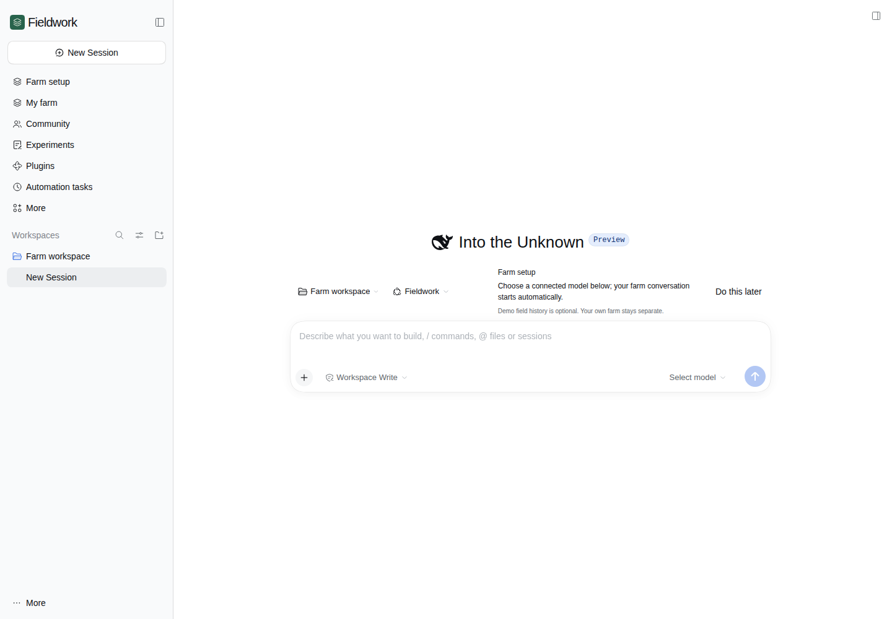
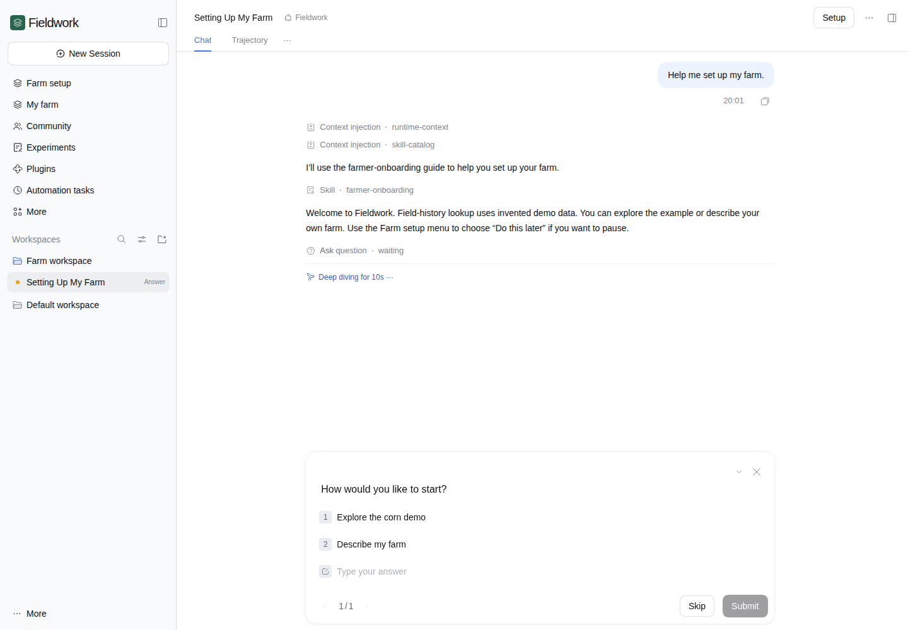
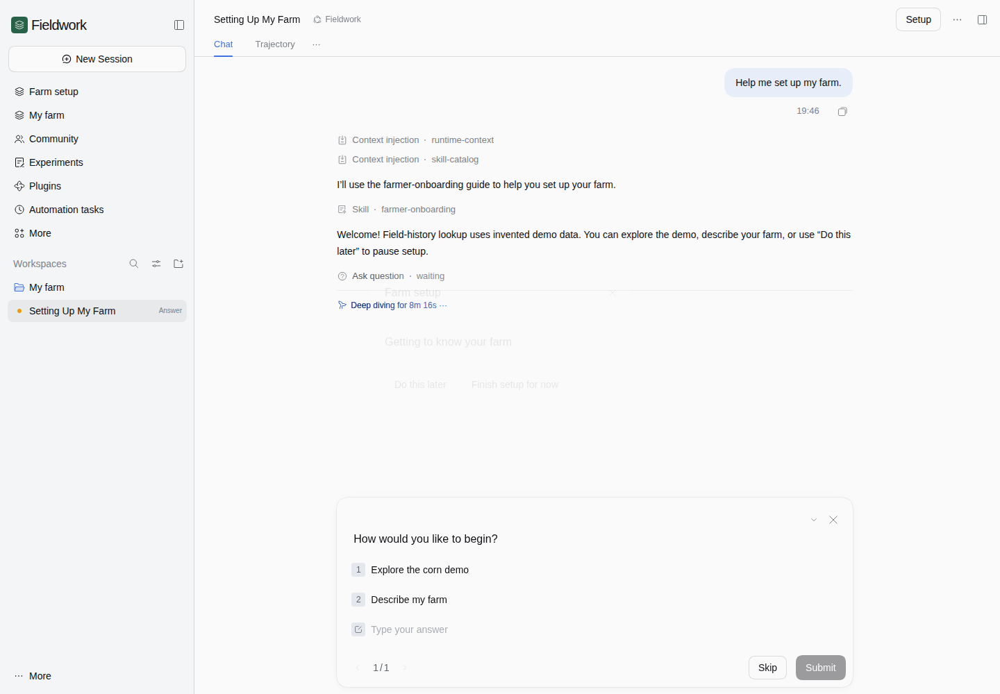
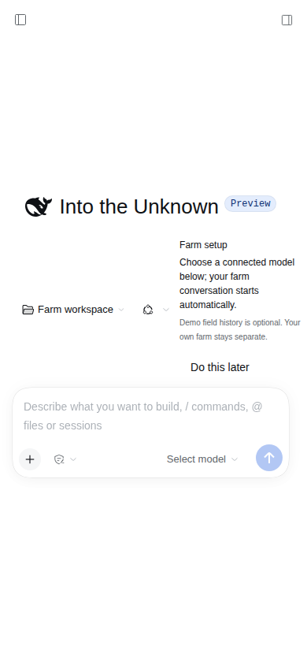
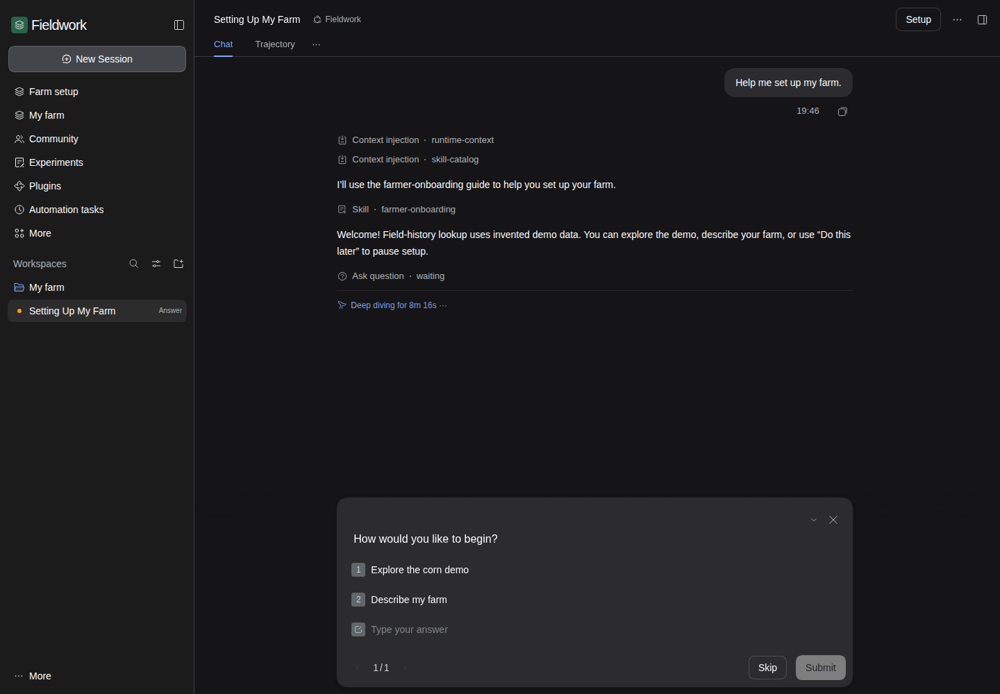

# 内置入门截图

[English](README.md) | 中文

内置 Fieldwork 设置流程的原生 Harness 实际截图，捕获于 2026-11-14。模型设置视图位于模型请求之前。首个问题及等待状态来自真实 `gpt-6.1-sol` Codex 订阅对话，并非无密钥测试提供商。未输入真实农场信息。

## 连接智能体

已保存的设置对话等待已连接的模型。

## 首个农场问题

选择模型后，Codex 加载入门技能并询问如何开始。

## 暂停或结束

原生问题等待回答时，Setup 菜单仍然可用。

## 手机布局

模型设置提示及控件适配 390 像素的手机视口。

## 深色主题

深色模式中的原生入门问题及 Setup 控件。

预览验证了选择模型、自动加载技能、首个原生问题、暂停等待中的问题，以及重新打开同一 Session 而不发送第二次问候。独立的无密钥浏览器检查覆盖预配置模型、重新加载、多标签及明确结束。田地历史查询仍使用虚构演示数据，完整入门对话尚未完成资格验证。参见[入门指南](../../onboarding/README.zh.md)。
