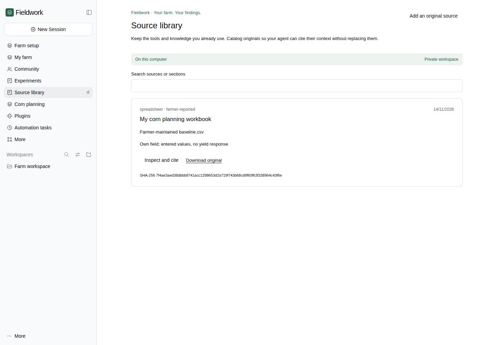
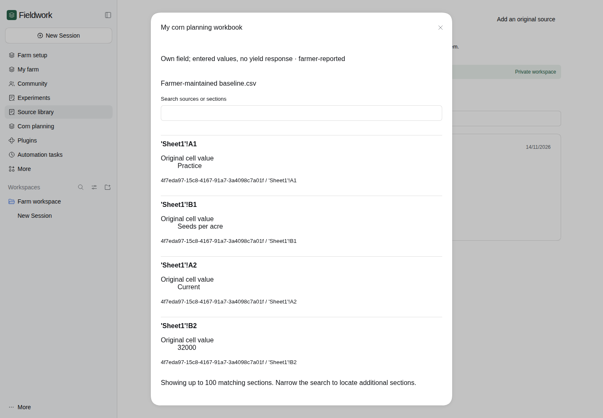
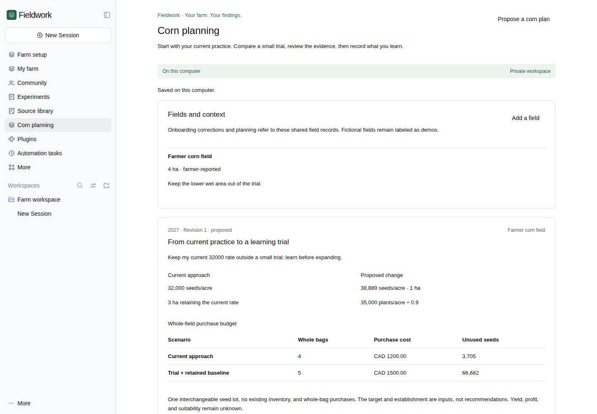
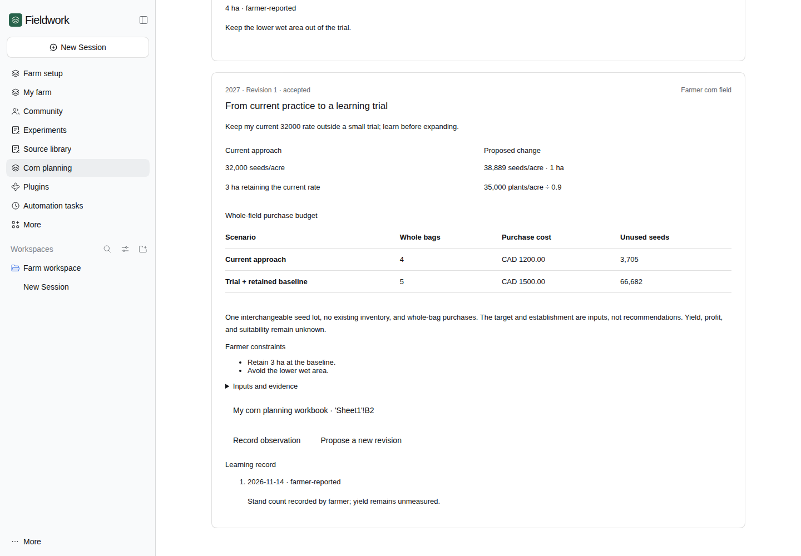

# Corn planning and source library

English | [中文](README.zh.md)

Actual native Harness captures from `fieldwork/ui/research.browser.test.mjs`. Every field, quote, spreadsheet value, and observation shown is fictional test data. The workflow deliberately labels the establishment estimate as assumed. No farm production result is claimed.

## Keep the original workflow

Import an original spreadsheet and retain its bytes, source identity, capture time, and content hash.

Inspect exact cell locations. XLSX formulas retain cached values rather than being executed during import.

## Review a corn decision

Preserve the farmer baseline, allocate a small trial, and compare whole-field purchase budgets. Whole-bag rounding can increase the purchase budget without saying anything about yield or profit.

## Retain what was learned

Acceptance fixes the revision, method version, inputs, and results. Dated observations stay with that revision; a later proposal preserves the earlier record.

