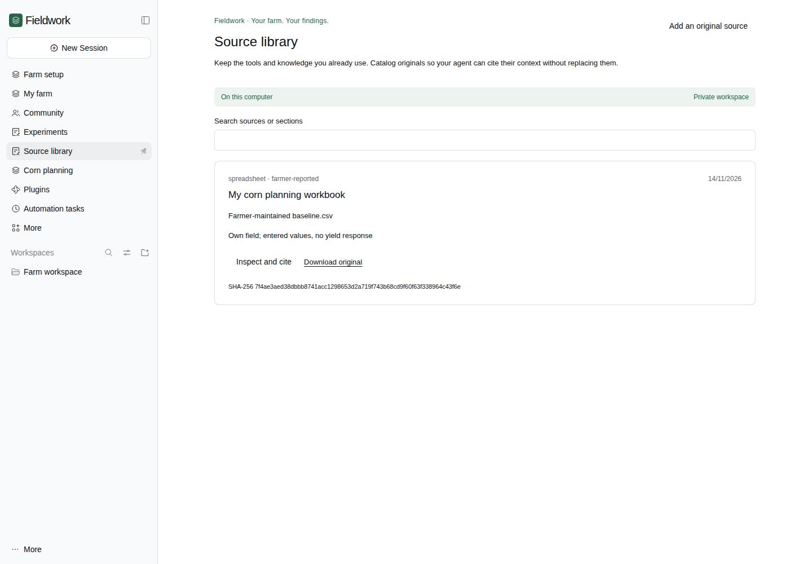
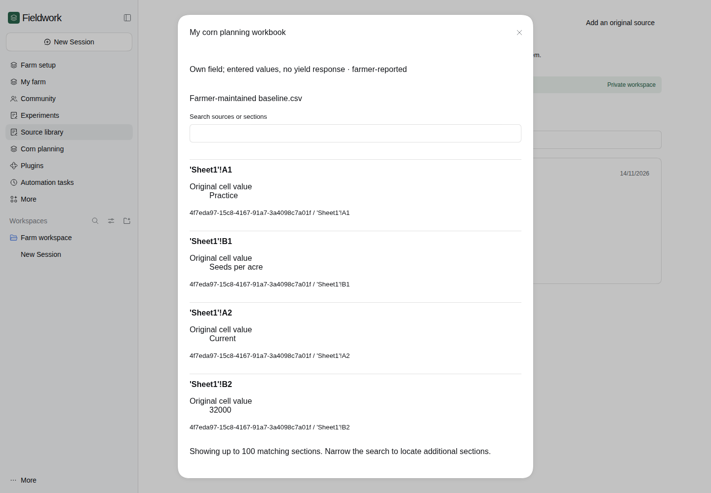
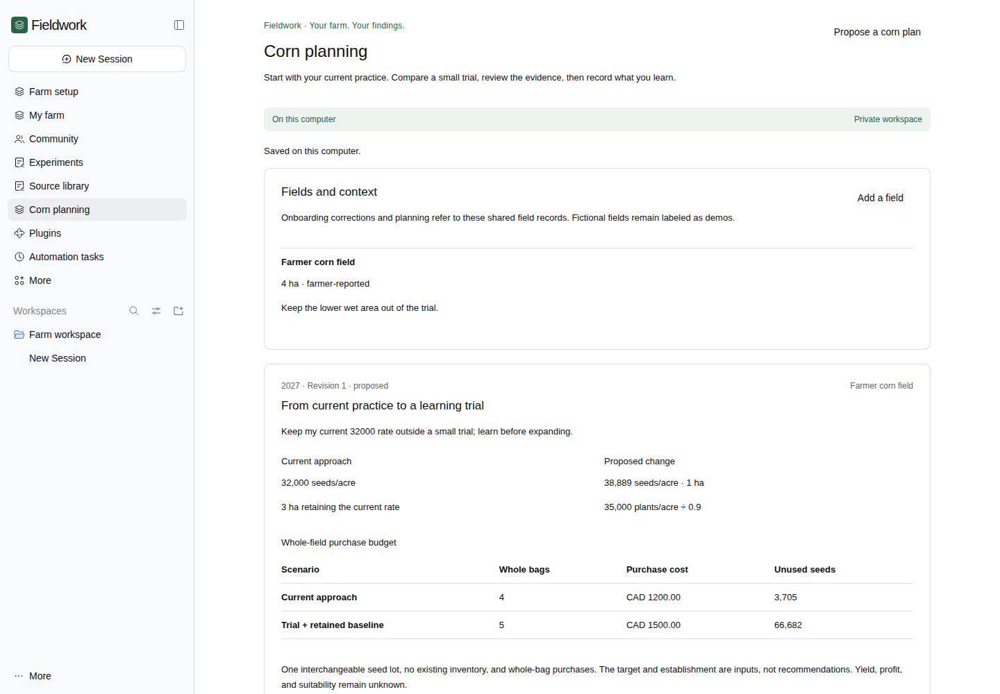
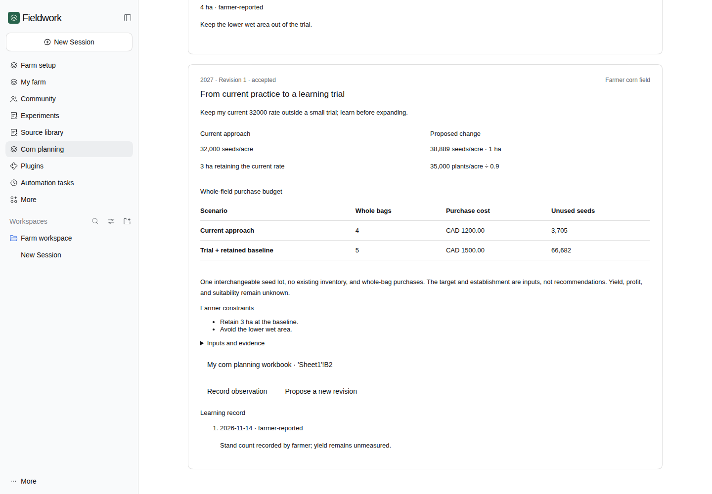

# 玉米规划及来源库

[English](README.md) | 中文

来自 `fieldwork/ui/research.browser.test.mjs` 的原生 Harness 实际截图。所有田块、报价、表格值和观察均为虚构测试数据。流程明确把成苗比例标记为假设，不声称获得任何实际生产结果。

## 保留原有流程

导入原始电子表格，保留原始字节、来源身份、采集时间及内容哈希。

查看准确单元格位置。XLSX 公式保留缓存值，不在导入时执行。

## 审核玉米决策

保留农户原做法，分配小面积试验并比较整块田采购预算。整袋取整可能提高采购预算，但不说明产量或利润。

## 保留学习记录

接受后固定方案版本、计算方法版本、输入及结果。带日期的观察保留在该版本，新方案保留此前记录。

