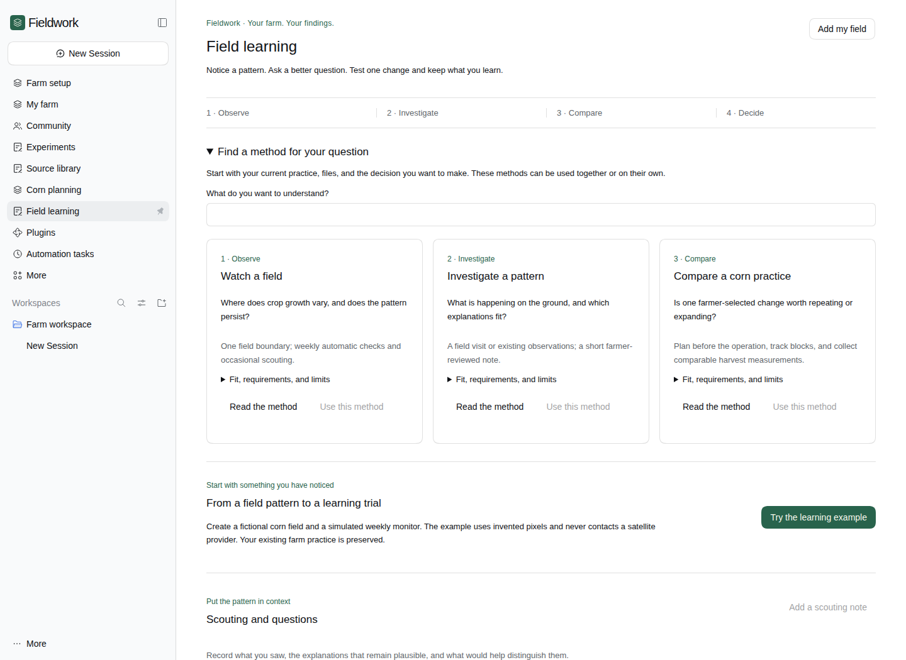
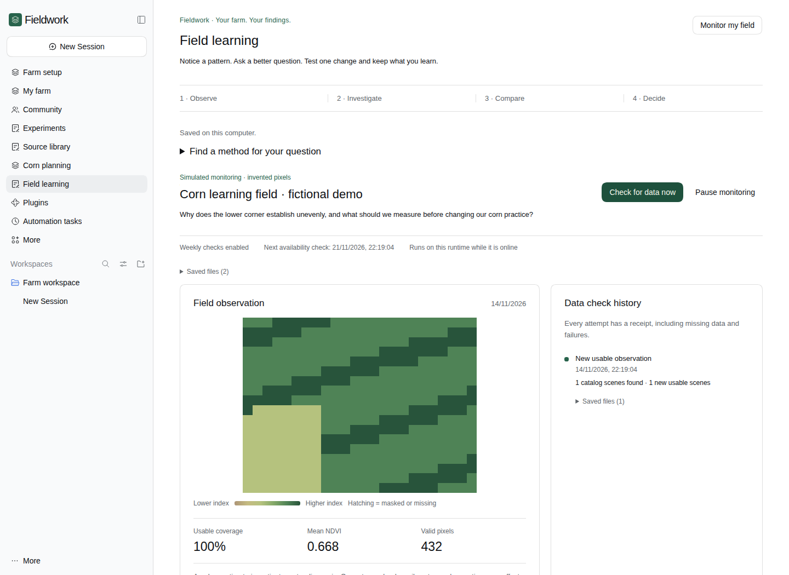
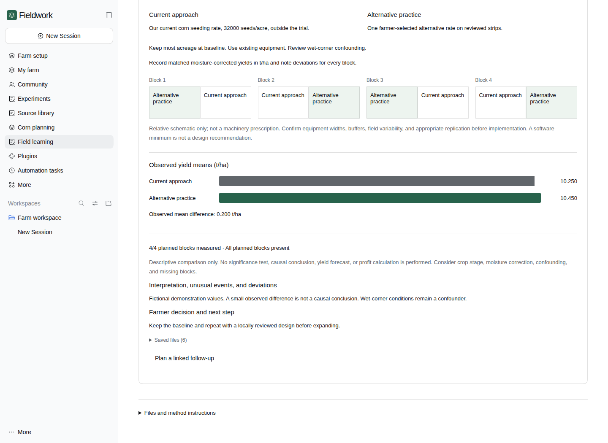

# Field learning

English | [中文](README.zh.md)

Actual native Harness captures from `fieldwork/ui/learning.browser.test.mjs`. All fields, imagery pixels, harvest values, and notes shown are fictional test data. The application also has a live Sentinel-2 provider, verified separately against public reference imagery; these screenshots demonstrate the simulated farmer journey.

## Discover a method

Choose by question, effort, requirements, and limitations. Read the method instructions before activation.

## Check data availability

The monitor shows an observation map, usable coverage, and receipts for every attempt. A second check of the same scene records no new data. Weekly checking does not guarantee a usable image.

## Keep a reviewed learning record

Scouting links to a comparison draft. The farmer reviews the baseline, change, measurements, and layout, then records paired measurements, interpretation, and a decision. This example keeps the baseline and proposes another trial; the observed difference is descriptive.

