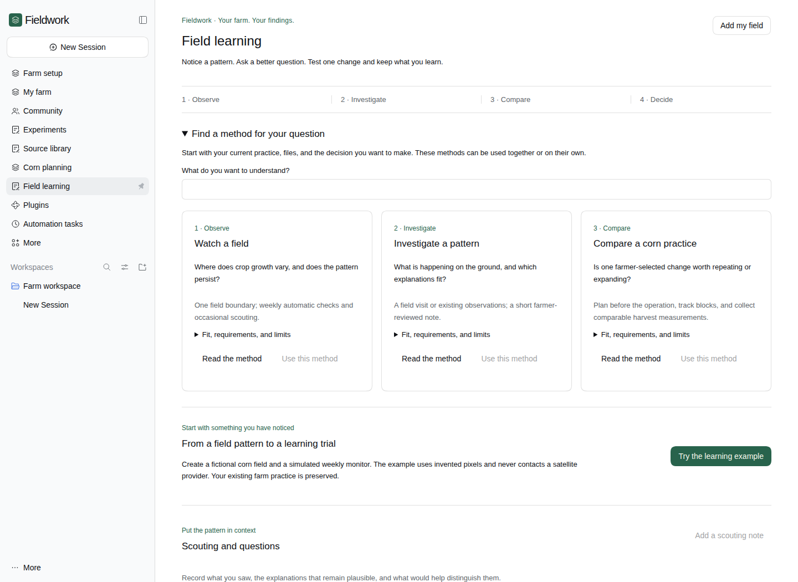
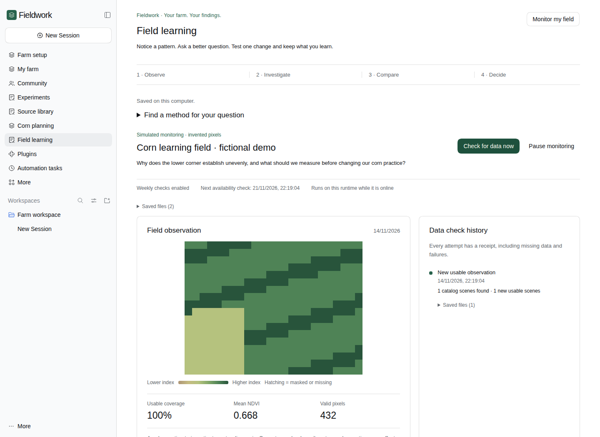
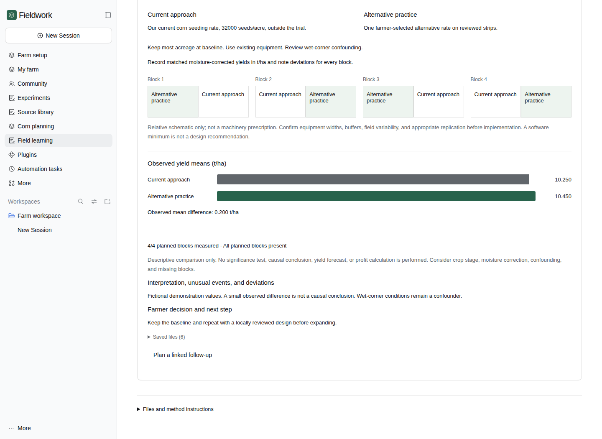

# 田间学习

[English](README.md) | 中文

来自 `fieldwork/ui/learning.browser.test.mjs` 的原生 Harness 实际截图。所有展示的田块、影像像素、收获值及笔记均为虚构测试数据。应用还包含已单独用公开参考影像验证的实时 Sentinel-2 供应商；这些截图展示模拟农户流程。

## 发现方法

按问题、工作量、要求及局限选择。启用前阅读方法说明。

## 检查数据可用性

监测展示观察地图、可用覆盖率及每次尝试的回执。再次检查同一场景会记录无新数据。每周检查不保证获得可用影像。

## 保留已审核的学习记录

巡田关联比较草稿。农户审核原做法、改变、测量及布局，再记录配对测量、解释及决定。本例保留原做法并建议再次试验；观察差异仅为描述性结果。

