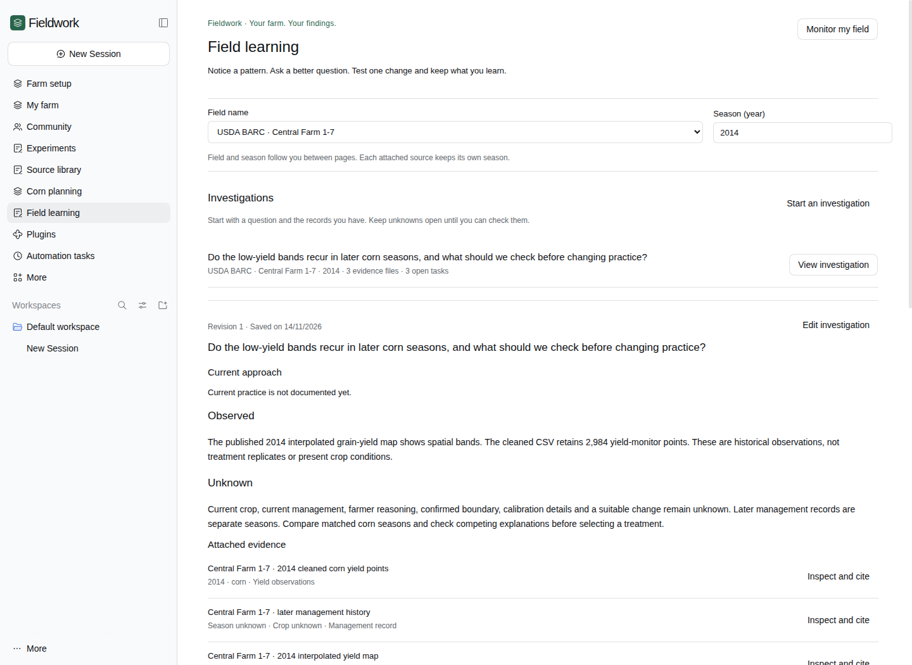
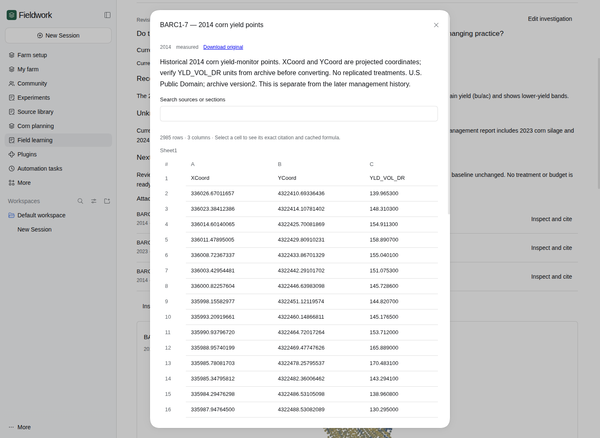
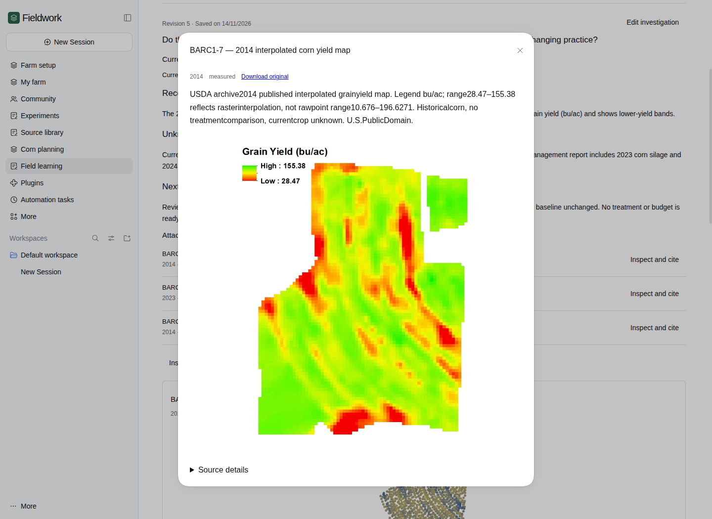
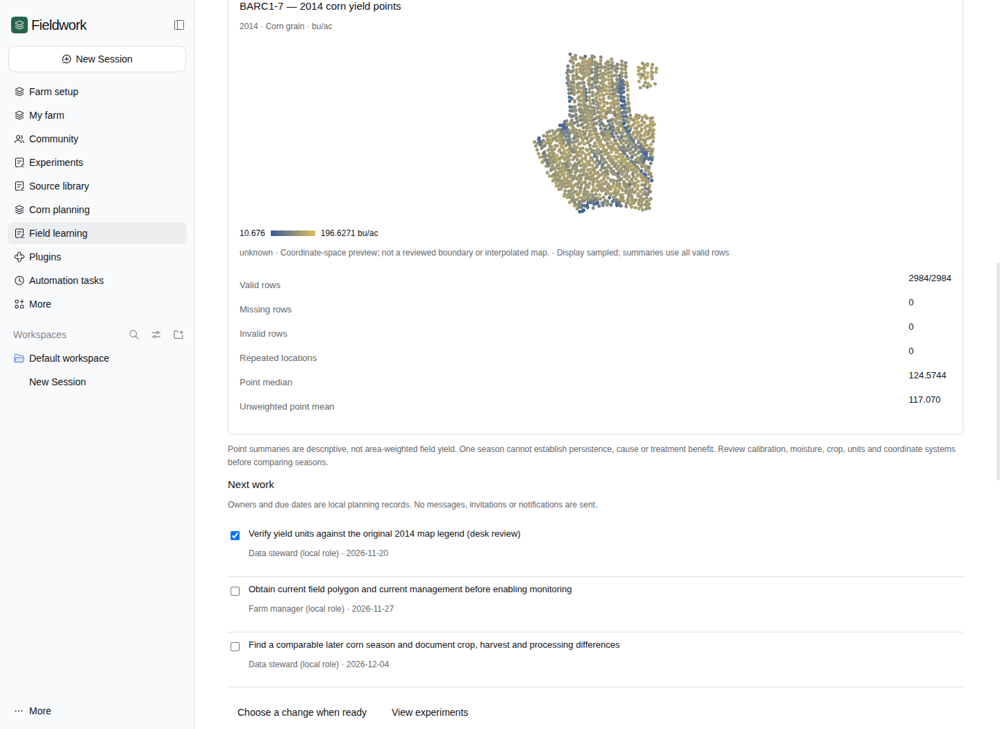
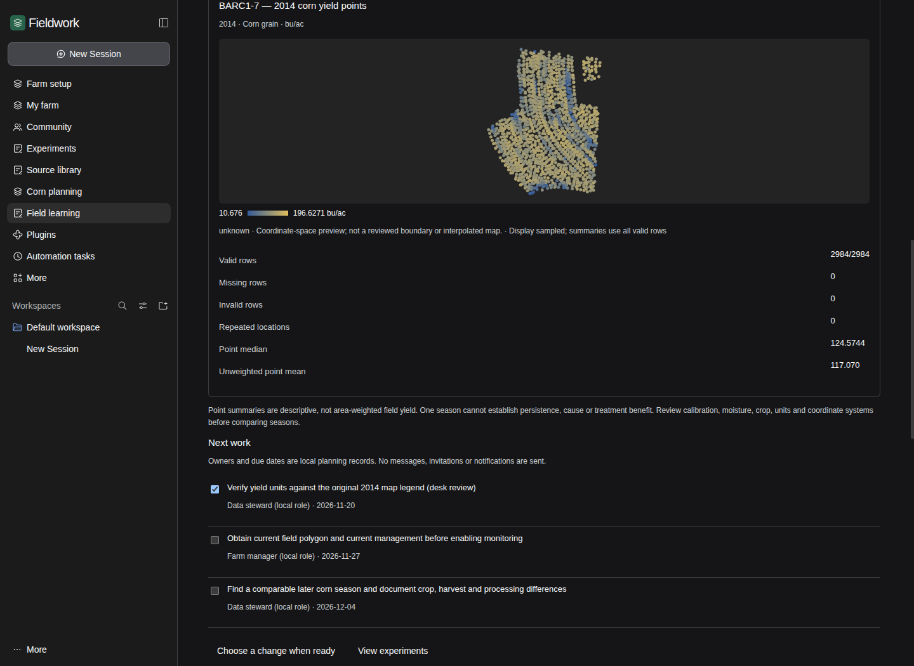
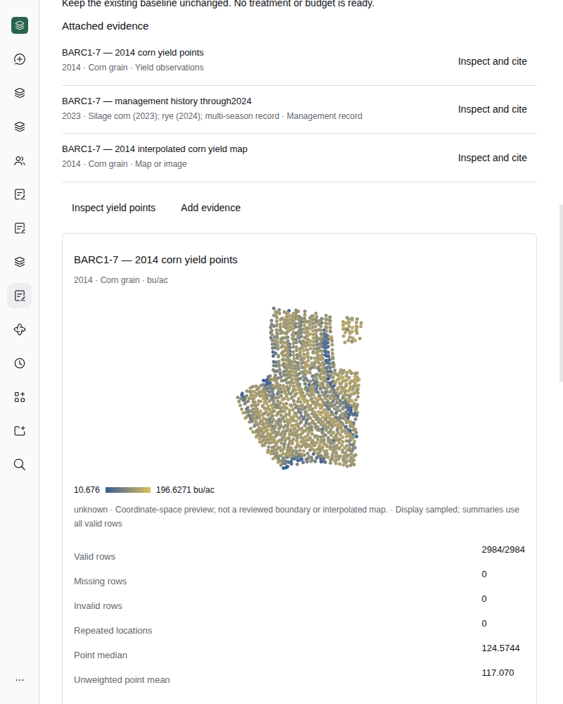

# Beltsville investigation

English | [中文](README.zh.md)

Actual native Harness captures from the [USDA BARC public-data case](../../examples/beltsville/README.md). A separate agent exercised the real files, review dialogs, quality checks, local task updates, and restart recovery. The 2014 yield observations and later management records keep separate context. Owners and dates shown are local planning examples; completing the units check records desk review, not a field visit.

## Start with a question

The public example retains unknown current practice and links evidence to the same investigation. It does not create a monitor, budget, or treatment trial.

## Read the original evidence

The worksheet is a paginated table with exact cell citations. The original published map retains its legend. PDF records use paginated extracted text and an original download.

## Inspect quality and plan next work

The point preview preserves coordinate aspect ratio. Descriptive summaries use all 2,984 valid rows; the displayed plot is sampled. This is not an area-weighted field yield or a causal comparison. A current boundary and matched later corn seasons remain open work.

