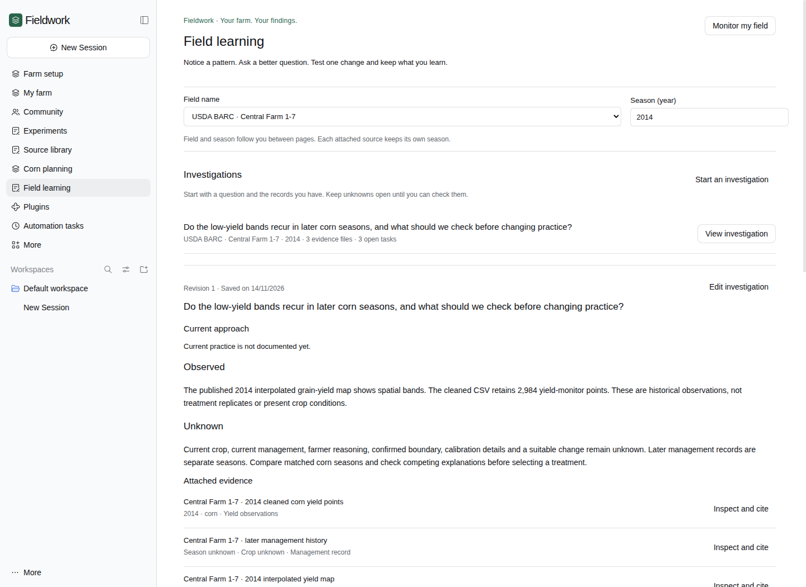
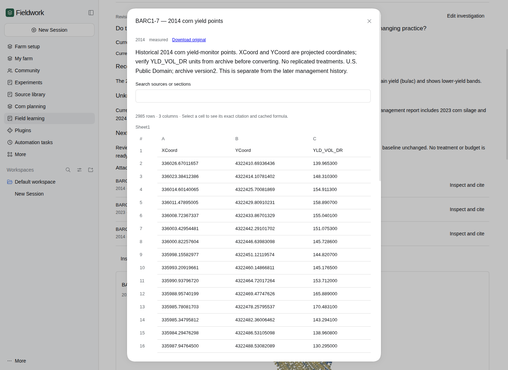
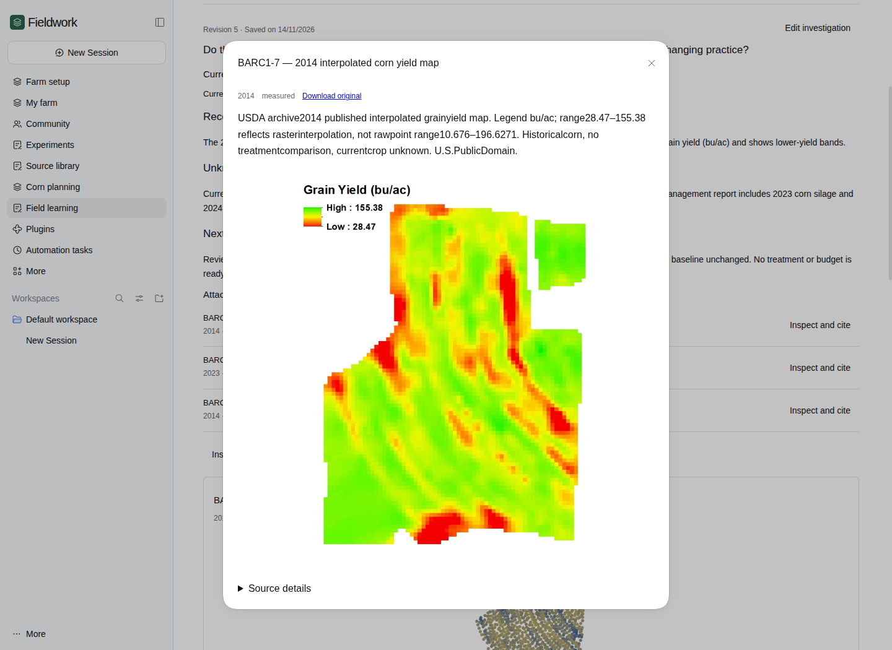
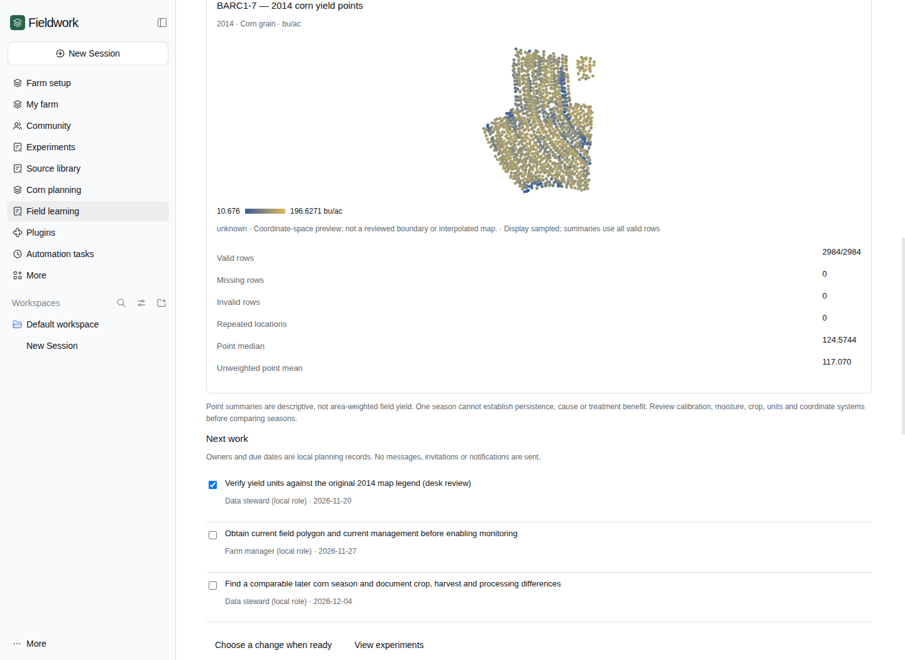
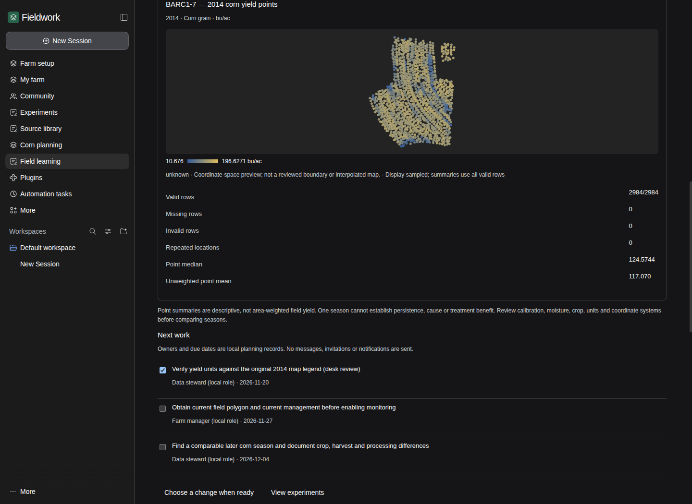
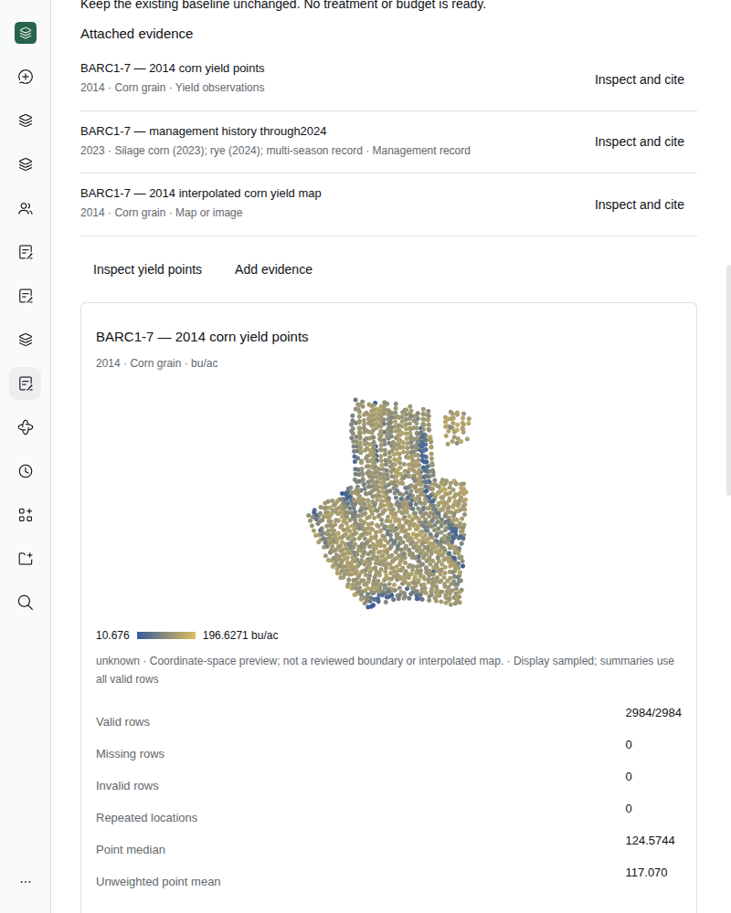

# Beltsville 调查

[English](README.md) | 中文

这些是 [USDA BARC 公开数据示例](../../examples/beltsville/README.zh.md)的实际原生 Harness 截图。独立智能体操作真实文件、审核对话框、质量检查、本地任务更新和重启恢复。2014 年产量观察与较晚的管理记录保留各自背景。显示的负责人及日期为本地规划示例；完成单位检查记录的是案头审核，并非田间访问。

## 从问题开始

公开示例保留未知的当前做法，并将证据关联至同一调查，不创建监测、预算或处理试验。

## 阅读原始证据

表格按页显示，并提供精确单元格引用。已发表原始地图保留图例。PDF 记录使用分页提取文本并提供原件下载。

## 检查质量并规划下一步

点预览保持坐标纵横比例。描述性汇总使用全部 2,984 个有效行，显示的点图经过抽样。这不是按面积加权的田块产量，也不是因果比较。当前边界及匹配的后续玉米季节仍是待办任务。

