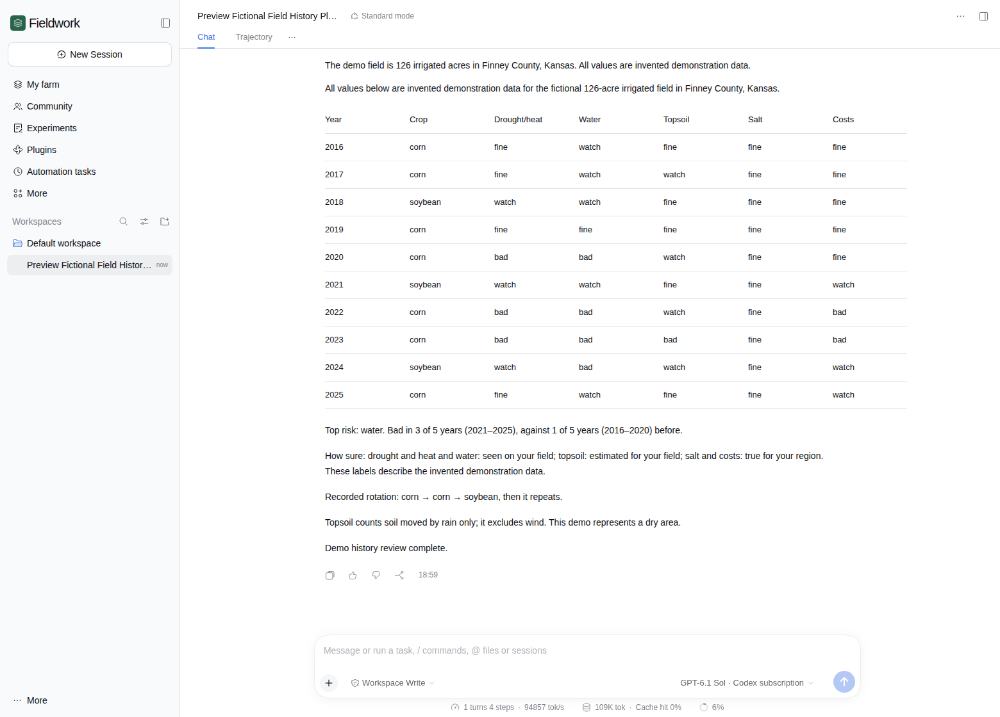
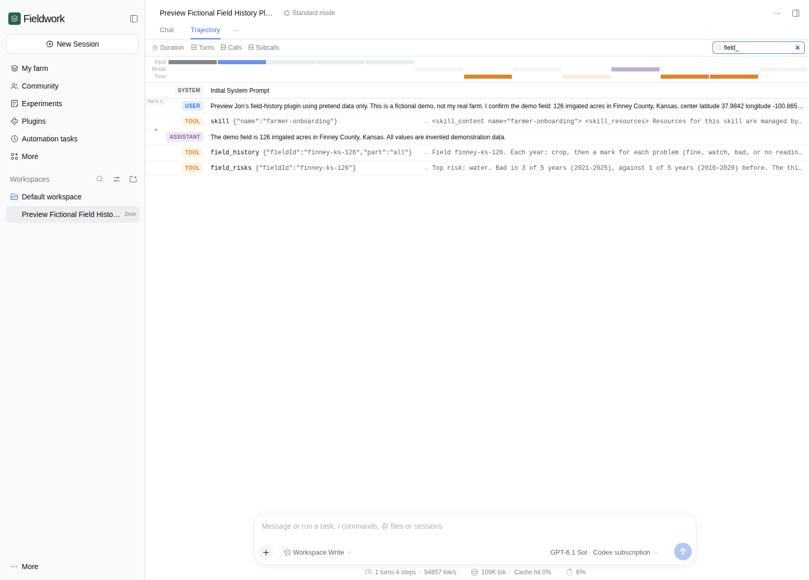
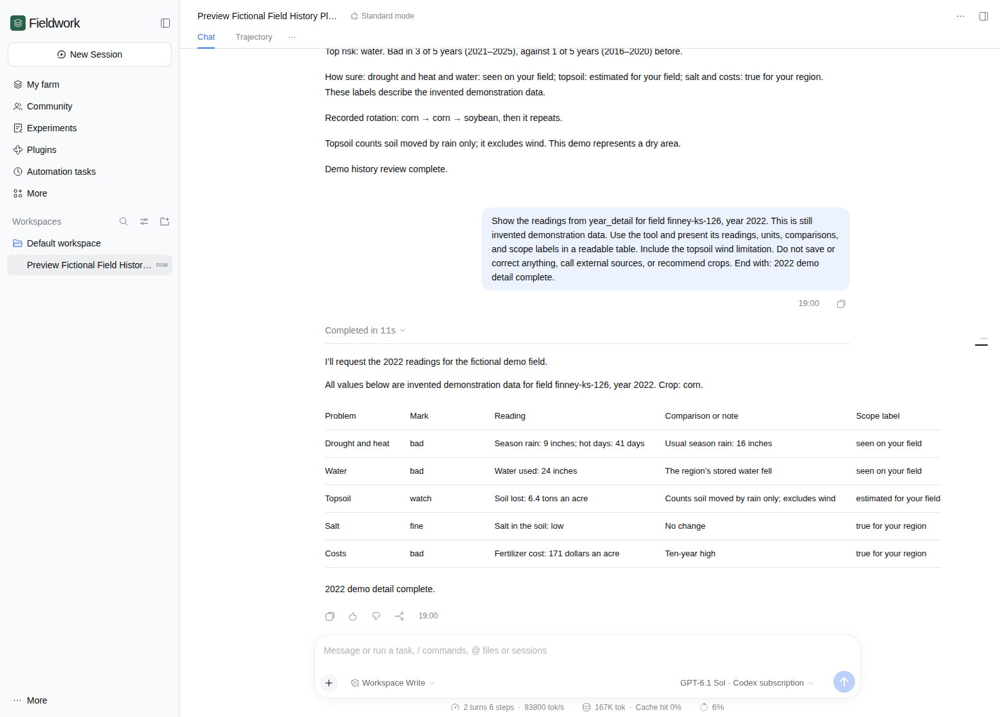

# Jon’s field-history plugin preview

English | [中文](README.zh.md)

Actual native Harness captures of Jonathan Trueblood’s plugin on [onboarding-field-history](https://github.com/Metaspectral/fieldwork/tree/onboarding-field-history/fieldwork/onboarding), captured on 2026-11-14 from the commit titled “Add field history and onboarding plugin with pretend and real data”. The plugin is now merged into main; these captures document the earlier branch preview. These images are generated chat views of real tool results, not a dedicated field-history page.

All field details, crop history, readings, and risk levels are invented demonstration values from the plugin’s default pretend mode. No field coordinates were sent to external data services in this preview.

## Crop history

A real `gpt-6.1-sol` Codex subscription conversation loads the onboarding skill and calls `find_field`, `field_history`, and `field_risks`. The fictional example is 126 irrigated acres in Finney County, Kansas, with a corn/soybean history. The table is model-formatted from the tool results.



## Tool trace

The native Trajectory view filtered to field tools shows the calls behind the history. The plugin registers six tools globally; this capture uses Standard mode alongside Fieldwork’s branding and pages. It does not demonstrate a restricted onboarding agent preset.



## One year’s readings

A follow-up calls `year_detail` for 2022. The response labels the values as invented, retains units and evidence scopes, and states that the topsoil estimate excludes wind.



## Verification and limits

- All 46 supplied rule and tool tests passed without network calls.
- The plugin loaded alongside the current Fieldwork tool, UI, and Codex plugins.
- The real-model preview exercised skill discovery and the four read tools. Correction and note writes were not exercised through a model, and the full interactive onboarding sequence was not tested.
- The six tools are `find_field`, `field_history`, `year_detail`, `field_risks`, `correct_year`, and `save_field_note`.
- Jon’s [handoff](https://github.com/Metaspectral/fieldwork/blob/onboarding-field-history/fieldwork/onboarding/HANDOFF.md) documents approximate field boundaries, unvalidated crop assumptions, missing data integrations, and other limits. The risk levels are not validated agronomic advice.
- Field history currently has a separate store from My farm. Before integrating writes, align correction/note approval with Fieldwork’s native approval policy.

To try it from main, install dependencies, run `pnpm run fieldwork:build`, then:

```sh
DSH_HOME="$PWD/.fieldwork/jon-preview" FIELDWORK_PRETEND=1 pnpm run fieldwork:start --patch fieldwork/onboarding/dev.patch.yml --no-open
```
