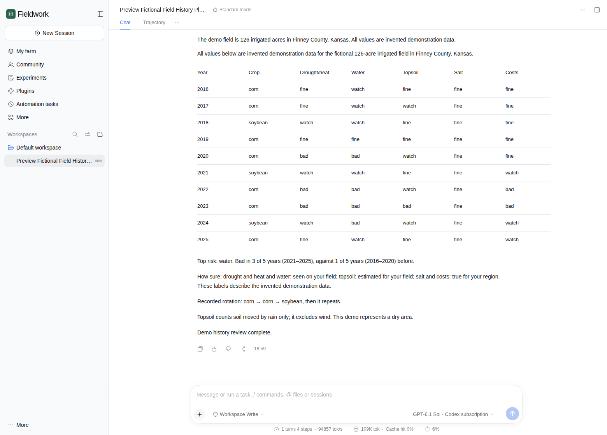
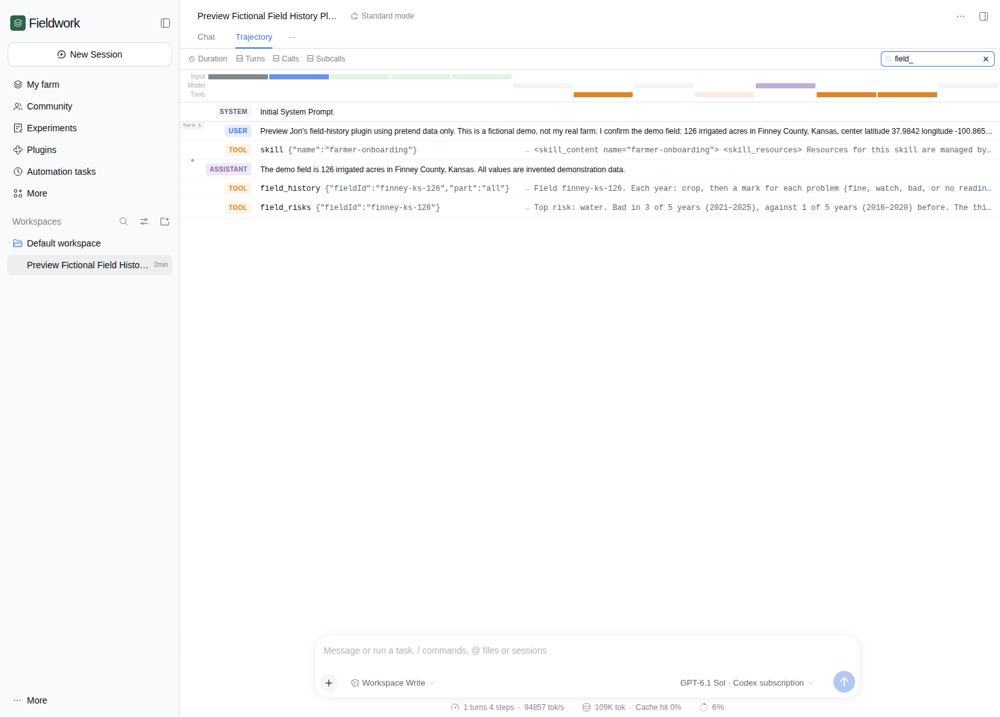
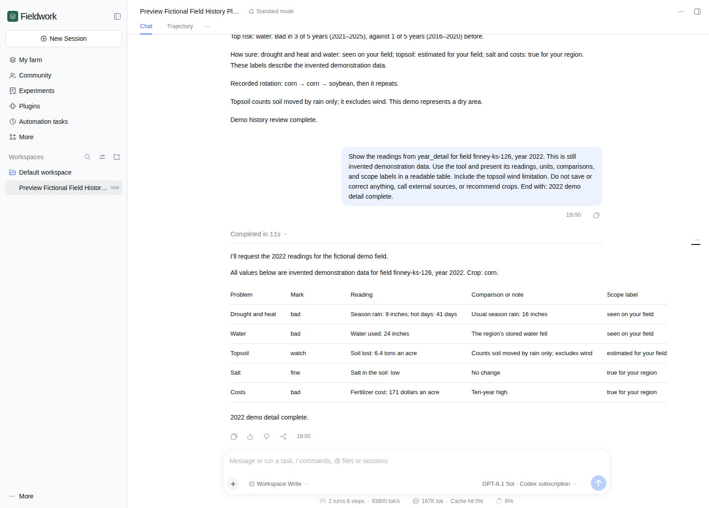

# Jon 的田地历史插件预览

[English](README.md) | 中文

Jonathan Trueblood 的 [onboarding-field-history](https://github.com/Metaspectral/fieldwork/tree/onboarding-field-history/fieldwork/onboarding) 插件的原生 Harness 实际截图，捕获于 2026-11-14，来自标题为“Add field history and onboarding plugin with pretend and real data”的提交。插件位于该分支，尚未合并到 main。这些图片是真实工具结果的聊天视图，并非专用田地历史页面。

所有田地详情、作物历史、读数及风险等级均为插件默认模拟模式中的虚构演示值。本次预览没有向外部数据服务发送田地坐标。

## 作物历史

真实的 `gpt-6.1-sol` Codex 订阅对话加载入门技能，并调用 `find_field`、`field_history` 和 `field_risks`。虚构示例位于堪萨斯州 Finney 县，为 126 英亩灌溉田地，具有玉米及大豆历史。表格由模型根据工具结果排版。



## 工具轨迹

原生 Trajectory 视图筛选田地工具，显示历史背后的调用。插件全局注册六个工具；截图使用 Standard 模式，并同时加载 Fieldwork 品牌及页面。它不展示受限的入门智能体预设。



## 单年读数

后续对话针对 2022 年调用 `year_detail`。回复标明读数为虚构值，保留单位及证据范围，并说明表土估计不包含风蚀。



## 验证及限制

- 提供的全部 46 项规则和工具测试均通过，未调用网络。
- 插件与当前 Fieldwork 工具、UI 及 Codex 插件一起成功加载。
- 真实模型预览验证了技能发现及四个只读工具。未通过模型测试更正及笔记写入，也未测试完整的交互式入门流程。
- 六个工具为 `find_field`、`field_history`、`year_detail`、`field_risks`、`correct_year` 和 `save_field_note`。
- Jon 的[交接文档](https://github.com/Metaspectral/fieldwork/blob/onboarding-field-history/fieldwork/onboarding/HANDOFF.md)记录了近似田地边界、未经验证的作物假设、缺失的数据集成及其他限制。这些风险等级并非经过验证的农艺建议。
- 田地历史目前使用独立于 My farm 的存储。集成写入前，应将更正及笔记审批与 Fieldwork 原生审批策略对齐。

若要从 Jon 分支的检出目录尝试，请安装依赖，运行 `pnpm run fieldwork:build`，然后运行：

```sh
DSH_HOME="$PWD/.fieldwork/jon-preview" FIELDWORK_PRETEND=1 pnpm run fieldwork:start --patch fieldwork/onboarding/dev.patch.yml --no-open
```
